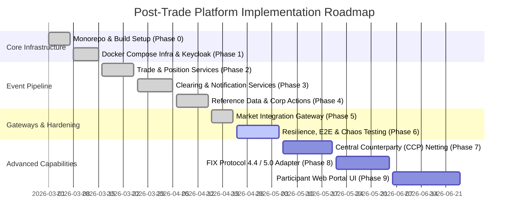

# 📋 Master Development Plan & Engineering Backlog
## Post-Trade Clearing & Settlement Platform

> **Status Dashboard:** Phase 1 – 5 Completed (`v1.0.0-SNAPSHOT`) | Phase 6 Active  
> **Author & Maintainer:** Pulkit Mathur ([@Pulkit1822](https://github.com/Pulkit1822))  
> **Architecture Pattern:** Event-Driven Microservices (Hexagonal + CQRS + Transactional Outbox)

---

## 🎯 Executive Roadmap & Progress Summary



---

## 📊 Phase-by-Phase Implementation Status

### ✅ Phase 0 — Monorepo Architecture & Build Foundation
* **Objective:** Establish Maven multi-module structure, dependency governance, and standardized event contracts.
* **Status:** `100% Completed`

| Task ID | Component | Deliverable | Status |
|:---:|:---|:---|:---:|
| `0.1` | **Root POM** | Parent `pom.xml` with Java 21 LTS, Spring Boot 3.3.5, Spring Cloud 2023.0.3, Testcontainers BOM | `[x] Done` |
| `0.2` | **Shared Libraries** | `shared-libraries` module with immutable domain event records (`TradeSubmittedEvent`, `TradeValidatedEvent`, `PositionUpdatedEvent`, `SettlementCompletedEvent`) | `[x] Done` |
| `0.3` | **Domain DTOs & Enums** | Standardized `TradeRequest`, `TradeResponse`, `TradeValidationStatus`, `CorporateActionType` | `[x] Done` |
| `0.4` | **Domain Exceptions** | Custom exceptions: `InsufficientPositionException`, `InstrumentNotFoundException`, `DuplicateTradeException` | `[x] Done` |

---

### ✅ Phase 1 — Infrastructure, Security & Observability Fabric
* **Objective:** Deploy local orchestration for all persistent stores, Kafka brokers, IAM, and telemetry.
* **Status:** `100% Completed`

| Task ID | Component | Deliverable | Status |
|:---:|:---|:---|:---:|
| `1.1` | **Docker Orchestration** | `docker-compose.yml` for PostgreSQL 16, Kafka + Zookeeper, Redis 7.2, Kafka UI, Prometheus, Grafana, ELK | `[x] Done` |
| `1.2` | **Kafka Topic Provisioning** | Automated broker setup provisioning 8 partitioned topics (`trade-submitted`, `trade-validated`, `position-updated`, etc.) with `partitions=3` | `[x] Done` |
| `1.3` | **Keycloak IAM Realm** | Preconfigured `clearing-platform` realm export with clients (`api-gateway`, `frontend-client`) and roles (`participant`, `operations`, `admin`) | `[x] Done` |
| `1.4` | **Observability Plane** | Centralized Prometheus scrape configurations for Spring Actuator metrics and pre-provisioned Grafana dashboards | `[x] Done` |
| `1.5` | **Environment Manager** | Local CLI runner `dev.sh` for starting, stopping, tailing logs, health checks, and running automated E2E tests | `[x] Done` |

---

### ✅ Phase 2 — Core Trade Ingestion & Position Engine
* **Objective:** Deliver atomic trade persistence, deadlock-free position reservation, and oversell guard.
* **Status:** `100% Completed`

| Task ID | Component | Deliverable | Status |
|:---:|:---|:---|:---:|
| `2.1` | **Trade Service Entity** | `Trade.java` JPA entity, `TradeStatus.java` state machine, Flyway `V1__initial_schema.sql` and `V2__rename_account_columns.sql` | `[x] Done` |
| `2.2` | **Trade Ingestion API** | REST `TradeController.java` (`POST /api/v1/trades`, `GET /api/v1/trades/{id}`) with Bean Validation | `[x] Done` |
| `2.3` | **Trade Kafka Publisher** | `TradeEventPublisher.java` producing `trade-submitted` events with `buyerAccountId` partition key | `[x] Done` |
| `2.4` | **Position Service Book** | `Position.java` entity, `PositionRepository.java`, and account balance lookups | `[x] Done` |
| `2.5` | **Deadlock-Free Locking** | `PositionValidationService.java` implementing alphabetical ID lock ordering to eliminate circular-wait deadlocks under high concurrency | `[x] Done` |
| `2.6` | **Atomic Position Updates** | Real-time debiting of sellers, crediting of buyers, and emission of `position-updated` events | `[x] Done` |
| `2.7` | **Oversell Protection** | Validation guard catching insufficient security balances and publishing rejection events | `[x] Done` |

---

### ✅ Phase 3 — Clearing, Settlement & Notification Pipeline
* **Objective:** Coordinate bilateral Delivery-versus-Payment (DvP) settlement and multi-channel advisories.
* **Status:** `100% Completed`

| Task ID | Component | Deliverable | Status |
|:---:|:---|:---|:---:|
| `3.1` | **Clearing Service Model** | `Settlement.java` entity with `SettlementStatus` (`PENDING`, `SETTLED`, `FAILED`) and Flyway schema | `[x] Done` |
| `3.2` | **Clearing Kafka Consumer** | Double-event consumer verifying both `trade-validated` and `position-updated` before finalizing | `[x] Done` |
| `3.3` | **DvP Settlement Engine** | `ClearingService.java` executing atomic settlement finalization and publishing `settlement-completed` | `[x] Done` |
| `3.4` | **Clearing REST API** | `ClearingController.java` (`GET /api/v1/clearing/settlements/{tradeId}`) | `[x] Done` |
| `3.5` | **Notification Service** | `Notification.java` audit store, consumer for `settlement-completed`, and simulated email/webhook dispatcher | `[x] Done` |
| `3.6` | **Notification History API**| `NotificationController.java` (`GET /api/v1/notifications/trades/{tradeId}`) | `[x] Done` |

---

### ✅ Phase 4 — Reference Data & Corporate Action Engines
* **Objective:** Master catalog for active financial instruments and lifecycle corporate action processing.
* **Status:** `100% Completed`

| Task ID | Component | Deliverable | Status |
|:---:|:---|:---|:---:|
| `4.1` | **Reference Data Catalog**| `Instrument.java` (ISIN, ticker, asset class) & `Participant.java` with Flyway database migration | `[x] Done` |
| `4.2` | **Redis Cache Layer** | Cache-aside lookup implementation caching active instruments with sub-millisecond latency | `[x] Done` |
| `4.3` | **Reference Event Publisher**| `ReferenceDataEventPublisher.java` broadcasting catalog updates to `reference-data-events` | `[x] Done` |
| `4.4` | **Corporate Action Engine** | `CorporateAction.java`, split/dividend calculator in `CorporateActionService.java` | `[x] Done` |
| `4.5` | **Corporate Event Publisher**| Kafka publisher emitting `corporate-action-events` to trigger position adjustments | `[x] Done` |

---

### ✅ Phase 5 — API Gateway & Market Integration Gateway
* **Objective:** Protocol translation, token validation, edge rate limiting, and external trade intake.
* **Status:** `100% Completed`

| Task ID | Component | Deliverable | Status |
|:---:|:---|:---|:---:|
| `5.1` | **Spring Cloud Gateway** | Non-blocking reactive gateway on port `8080` routing `/api/v1/trades/**`, `/api/v1/positions/**`, `/api/v1/clearing/**` | `[x] Done` |
| `5.2` | **OAuth2 / JWT Security** | Keycloak resource server filter validating token claims, expiration, and user roles | `[x] Done` |
| `5.3` | **Rate Limiting** | Redis-backed token bucket rate limiter protecting downstream microservices from traffic bursts | `[x] Done` |
| `5.4` | **Market Gateway Translator** | Protocol normalization engine in `market-integration-gateway:8088` mapping external trade inputs into canonical `TradeRequest` DTOs | `[x] Done` |

---

### 🔄 Phase 6 — Resilience, E2E Testing & Failure Recovery
* **Objective:** Comprehensive testing, Testcontainers suites, Dead Letter Queue (DLQ) retry policies, and fail-safe automation.
* **Status:** `In Progress` (Target: May 2026)

| Task ID | Component | Focus Area | Status |
|:---:|:---|:---|:---:|
| `6.1` | **Testcontainers Integration** | Containerized integration tests across `trade-service` and `position-service` testing PostgreSQL & Kafka | `[x] Done` |
| `6.2` | **Automated E2E Suite** | `dev.sh test` executing automated multi-step funding $\rightarrow$ trading $\rightarrow$ DvP settlement $\rightarrow$ notification assertions | `[x] Done` |
| `6.3` | **DLQ Consumer & Replay** | Dedicated consumer listening on `trade-dead-letter` with dead-letter replay endpoint | `[ ] Planned` |
| `6.4` | **Idempotency Outbox Engine**| Explicit outbox table with polling publisher to safeguard against edge-case Kafka broker drops | `[ ] In Progress` |
| `6.5` | **Chaos Engineering** | Toxiproxy / chaos test scripts simulating network latency, dropped packets, and database disconnects | `[ ] Planned` |

---

### ⏳ Phase 7 — Central Counterparty (CCP) Netting Engine
* **Objective:** Batch multilateral netting algorithm compressing gross settlement volume into net bilateral cash and asset balances.
* **Status:** `Scheduled`

| Task ID | Component | Focus Area | Status |
|:---:|:---|:---|:---:|
| `7.1` | **Netting Batch Service** | Scheduled end-of-day job calculating net obligations per participant book | `[ ] Planned` |
| `7.2` | **Novation Logic** | Central counterparty legal substitution (CCP becomes buyer to every seller, seller to every buyer) | `[ ] Planned` |
| `7.3` | **Net Settlement Execution** | Transitioning high-frequency gross trades into single end-of-window DvP settlement instructions | `[ ] Planned` |

---

### ⏳ Phase 8 — Institutional Protocols & SWIFT Integration
* **Objective:** Direct matching engine interoperability via FIX and SWIFT ISO 20022 messaging.
* **Status:** `Scheduled`

| Task ID | Component | Focus Area | Status |
|:---:|:---|:---|:---:|
| `8.1` | **QuickFIX/J Gateway** | Ingestion of standard FIX 4.4 / 5.0 `ExecutionReport` (Tag 35=8) messages | `[ ] Planned` |
| `8.2` | **ISO 20022 Adapter** | Outbound generation of `pacs.008` (credit transfer) and `camt.053` bank settlement advisories | `[ ] Planned` |
| `8.3` | **Regulatory Audit Exporter**| Automated MiFID II / CAT regulatory trade feed generator | `[ ] Planned` |

---

### ⏳ Phase 9 — Participant Web Portal (Frontend)
* **Objective:** Responsive, real-time single-page application for broker-dealers and clearing operations.
* **Status:** `Scheduled`

| Task ID | Component | Focus Area | Status |
|:---:|:---|:---|:---:|
| `9.1` | **Trader Portal UI** | Real-time trade submission form, active order book status, and security balance monitor | `[ ] Planned` |
| `9.2` | **Operations Dashboard** | Clearing house monitoring console displaying Kafka consumer lag, settlement queues, and DLQ alerts | `[ ] Planned` |
| `9.3` | **WebSocket Feeds** | STOMP/WebSocket live stream pushing settlement notifications directly to the browser UI | `[ ] Planned` |

---

## 🛡️ Definition of Done (DoD) & Engineering Quality Gates

Every component merged into the platform must satisfy the following technical requirements:
1. **Compilation & Packaging**: Clean build via `mvn clean package` with zero compiler warnings on Java 21.
2. **Schema Safety**: All database modifications managed through incremental, idempotent Flyway migrations (`V{N}__{description}.sql`).
3. **Partition Ordering**: All Kafka topics modifying state must specify an explicit business key (`accountId` or `instrumentId`) to enforce in-order stream processing.
4. **Concurrency Safety**: Double-entry financial updates must enforce deterministic lock acquisition order to avoid RDBMS deadlocks.
5. **Observability**: Every service must expose Actuator endpoints (`/actuator/health`, `/actuator/prometheus`) and inject `correlationId` and `tradeId` into MDC logs.
6. **Zero Hardcoded Secrets**: All passwords, tokens, and broker URIs must be parameterized via environment variables with safe local defaults.

---

## 🚀 Immediate Next Action Items

1. **Verify Local Infrastructure**:
   ```bash
   ./dev.sh start
   ```
2. **Execute Full End-to-End Test**:
   ```bash
   ./dev.sh test
   ```
3. **Inspect Real-Time Message Streams**:
   Open Kafka UI at `http://localhost:8091` to verify topic partitions and consumer group offsets.