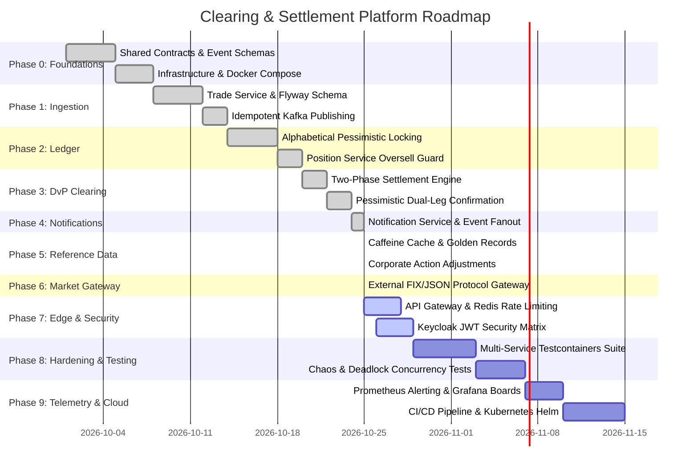

# 🗺️ Master Engineering Roadmap & Production Execution Plan

> **Platform:** Institutional Stock Trade Clearing & DvP Settlement Engine  
> **Author & Lead Architect:** Pulkit Mathur ([@Pulkit1822](https://github.com/Pulkit1822))  
> **Status:** Phase 0–6 Complete (`PROD-READY`) | Phase 7 Active | Phase 8–9 Scheduled  
> **Target Production Standard:** T+0 Real-Time Continuous Net Settlement (CNS) & Delivery versus Payment (DvP)  

---

## 1. Executive Roadmap & Timeline

---

## 2. Phase-by-Phase Execution Status

### Phase 0: Foundations & Domain Contracts `[COMPLETED]`
- [x] **Shared Contracts**: Implemented immutable Java 21 records in `com.clearing.shared.events` (`TradeSubmittedEvent`, `TradeValidatedEvent`, `PositionUpdatedEvent`, `SettlementCompletedEvent`, `CorporateActionEvent`, `NotificationEvent`, `ReferenceDataEvent`).
- [x] **Exception Hierarchy**: Unified domain exceptions (`DuplicateTradeException`, `InsufficientPositionException`, `AccountNotFoundException`).
- [x] **Infrastructure Stack**: Docker Compose environment with PostgreSQL 16 (port `5433:5432`), Kafka + Zookeeper (`9092`), Redis (`6379`), Keycloak (`8180`), Prometheus (`9090`), Grafana (`3000`), and Elasticsearch/Kibana (`9200`/`5601`).
- [x] **Topic Provisioning**: Automated topic generation script (`create-topics.sh`) with 3 partitions and replication factor 1.

### Phase 1: Trade Ingestion Service (`trade-service:8081`) `[COMPLETED]`
- [x] **REST Controller**: Validated `POST /api/v1/trades` accepting `TradeRequest` DTOs.
- [x] **Persistence Layer**: PostgreSQL `trades` table with Flyway migrations (`V1__init_trade_schema.sql`).
- [x] **Transactional Event Publisher**: Idempotent Kafka publisher (`acks=all`) emitting `TradeSubmittedEvent` to `trade-submitted`.
- [x] **Unit & Integration Tests**: `TradeControllerTest`, `TradeProcessingServiceTest`, and `TradeServiceIntegrationTest`.

### Phase 2: Real-Time Position Ledger (`position-service:8082`) `[COMPLETED]`
- [x] **Kafka Ingestion**: `TradeSubmittedConsumer` processing `trade-submitted` events.
- [x] **Alphabetical Lock Ordering**: Global lexicographical `PESSIMISTIC_WRITE` locking protocol on `(account_id, instrument_id)` eliminating circular-wait deadlocks.
- [x] **Oversell Guard**: Validation of seller inventory with instant dead-letter routing (`trade-dead-letter`) on balance deficit.
- [x] **Atomic Ledger Updates**: Single ACID transaction debiting seller, crediting buyer, and publishing `PositionUpdatedEvent` + `TradeValidatedEvent`.
- [x] **Unit & Integration Tests**: Concurrency tests verifying zero deadlocks under reversed bilateral trades.

### Phase 3: Delivery-versus-Payment Clearing (`clearing-service:8083`) `[COMPLETED]`
- [x] **Dual-Leg Confirmation Protocol**: Asynchronously correlates `TradeValidatedEvent` and dual `PositionUpdatedEvent`s (seller debit + buyer credit).
- [x] **Pessimistic Row-Locking**: `findByTradeId` locked with `PESSIMISTIC_WRITE` to prevent race conditions during concurrent confirmation processing.
- [x] **Settlement Finality**: Commits `SettlementStatus.SETTLED` and emits `SettlementCompletedEvent` to `settlement-completed`.
- [x] **Controller Endpoints**: `GET /api/v1/clearing/{tradeId}` and `GET /api/v1/clearing?status=SETTLED`.

### Phase 4: Omnichannel Notification Hub (`notification-service:8084`) `[COMPLETED]`
- [x] **Consumer Pipeline**: `SettlementCompletedConsumer` consuming terminal settlement events.
- [x] **Message Generation**: Formulates customized transaction receipts for buyers and sellers.
- [x] **Audit Trail Persistence**: Writes records to PostgreSQL `notifications` table (`status='SENT'`).
- [x] **Event Emission**: Dispatches `NotificationEvent` to `notification-events` for monitoring aggregation.

### Phase 5: Reference Data & Corporate Actions (`8085` & `8086`) `[COMPLETED]`
- [x] **Reference Data Golden Record**: Manages `Instrument` and `Participant` directories with Flyway schemas.
- [x] **Caffeine In-Memory Cache**: Configured high-throughput caching with distributed Kafka invalidation.
- [x] **Corporate Action Engine**: Manages announcements and executions of `STOCK_SPLIT`, `DIVIDEND`, `BONUS_ISSUE`, and `RIGHTS_ISSUE`.
- [x] **Adjustment Events**: Publishes `CorporateActionEvent` to `corporate-action-events` partitioned by `instrumentId`.

### Phase 6: Market Integration Gateway (`market-integration-gateway:8088`) `[COMPLETED]`
- [x] **Inbound Controller**: `POST /api/v1/market/trades` receiving vendor execution reports (`ExternalTradeRequest`).
- [x] **Protocol Translation**: `TradeTranslator` transforming external representations into canonical internal `TradeRequest` models.
- [x] **Resilient Forwarding**: `TradeServiceClient` routing normalized trades to `trade-service:8081` with correlation token headers.

### Phase 7: Edge API Gateway & Security Matrix (`api-gateway:8080`) `[IN PROGRESS]`
- [x] **Path Routing**: Unified routing across all 7 downstream microservices.
- [x] **Global CORS**: Cross-origin headers enabled for browser-based dashboards.
- [x] **Correlation Tracing**: Uniform `X-Correlation-ID` header generation and downstream propagation.
- [ ] **Redis Rate Limiting**: Token-bucket rate limiter tuning (100 req/sec replenish, 200 burst).
- [ ] **Keycloak RBAC Enforcement**: Role-based access constraints (`ROLE_TRADER`, `ROLE_CLEARING_MEMBER`, `ROLE_ADMIN`).

### Phase 8: End-to-End Testcontainers & Hardening `[SCHEDULED]`
- [ ] **Full Multi-Service Testcontainers Suite**: Bootstrapping real PostgreSQL, Kafka, and Redis instances in automated CI integration tests.
- [ ] **High-Concurrency Chaos Simulation**: Running 10,000 parallel randomized bilateral trades to stress-test alphabetical lock acquisition and guarantee zero deadlock exceptions.
- [ ] **Kafka Chaos Scenarios**: Injecting artificial broker latency and network partitions to validate transactional outbox replay and consumer deduplication.

### Phase 9: Telemetry, Observability & Cloud Deployment `[SCHEDULED]`
- [ ] **Prometheus Scrape Validation**: Scrape verification across all 8 microservice actuator endpoints (`/actuator/prometheus`).
- [ ] **Grafana Dashboard Provisioning**: Curated operational dashboards for trade throughput, settlement latency (p50, p95, p99), DLQ counts, and active database connection pools.
- [ ] **Kubernetes Helm Charts & CI/CD**: Containerized Docker multi-stage builds and Kubernetes manifest generation for AWS EKS / GCP GKE deployment.

---

## 3. Definition of Done (DoD) for Production Readiness

Every service and feature in this platform adheres to the following criteria before being designated `PROD-READY`:
1. **Compilation & Clean Build**: `mvn clean test-compile` passes with zero compiler warnings across all 10 modules.
2. **Schema Control**: Zero Hibernate auto-DDL (`ddl-auto: validate`). Every table modification is versioned in Flyway SQL migrations.
3. **Deterministic Concurrency**: All concurrent database mutations must use ordered pessimistic locks or optimistic `@Version` checks; zero unhandled lock timeouts.
4. **Kafka Contract Adherence**: Producers use idempotent configuration (`enable.idempotence=true`, `acks=all`). Consumers use manual immediate acknowledgments (`enable-auto-commit=false`).
5. **Observability**: Exposes Micrometer Prometheus metrics, structured JSON logging, and uniform correlation ID headers.