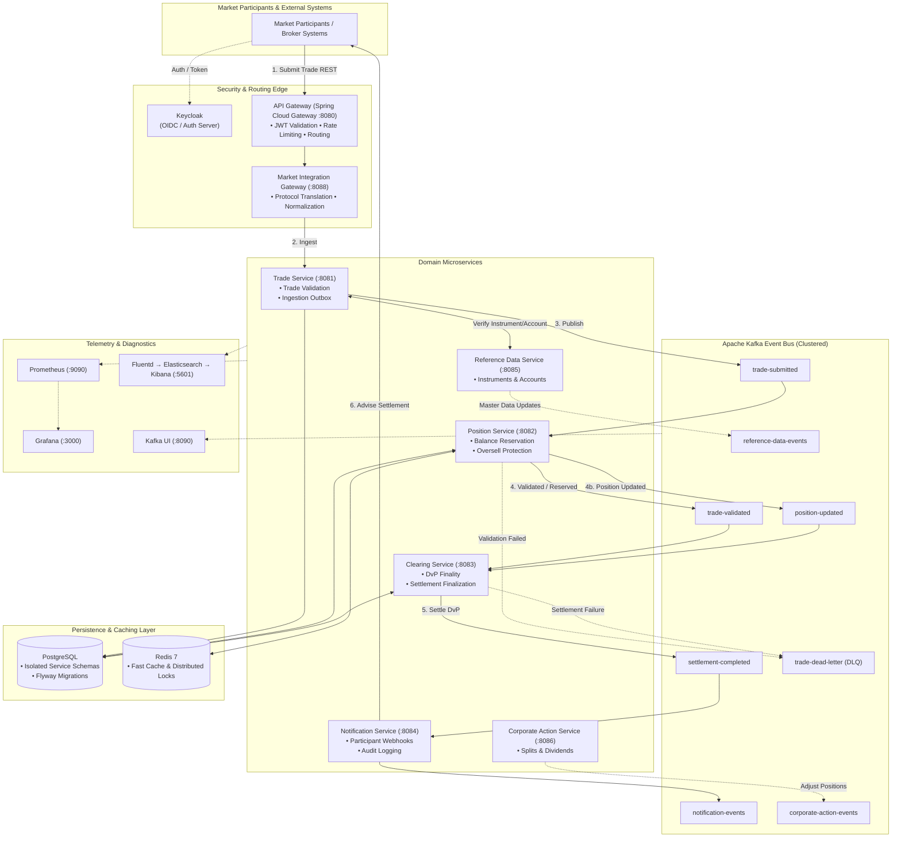
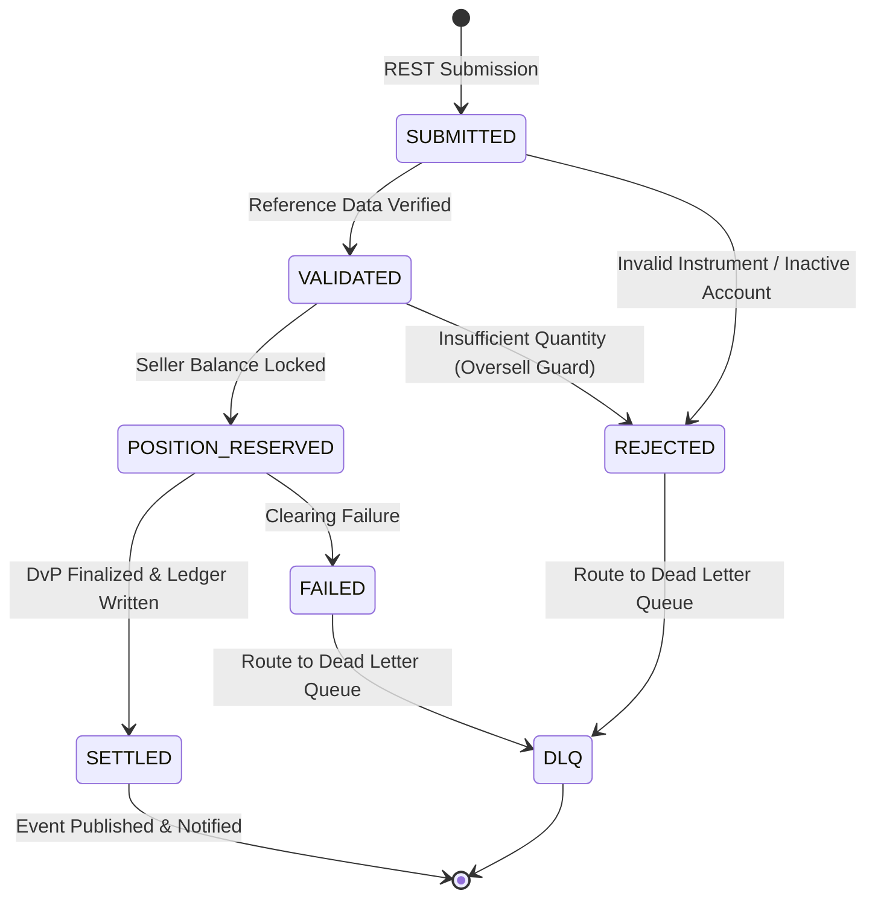

# 🏛️ Stock Trade Clearing & Settlement System

[](https://openjdk.org/projects/jdk/21/)
[](https://spring.io/projects/spring-boot)
[](https://kafka.apache.org/)
[](https://www.postgresql.org/)
[](https://redis.io/)
[](https://www.keycloak.org/)
[](https://www.docker.com/)
[](LICENSE)

> **High-Throughput, Resilient Post-Trade Processing Engine**  
> A distributed, event-driven financial trading backend engineered to orchestrate trade validation, double-entry position allocation, Delivery-versus-Payment (DvP) final settlement, and real-time transaction event streaming.

---

## 📑 Table of Contents

- [Overview & Domain Context](#-overview--domain-context)
- [Key Capabilities](#-key-capabilities)
- [Architecture & Data Flow](#-architecture--data-flow)
  - [System Architecture Diagram](#system-architecture-diagram)
  - [Trade Clearing & Settlement Lifecycle](#trade-clearing--settlement-lifecycle)
  - [Trade State Machine](#trade-state-machine)
- [Service Catalog & Port Matrix](#-service-catalog--port-matrix)
- [Kafka Event Streaming Architecture](#-kafka-event-streaming-architecture)
  - [Topic Topology](#topic-topology)
  - [Event Payloads & Contracts](#event-payloads--contracts)
  - [Ordering & Partitioning Strategy](#ordering--partitioning-strategy)
- [Data Integrity & Concurrency Controls](#-data-integrity--concurrency-controls)
- [Security & Identity (IAM)](#-security--identity-iam)
- [Tech Stack](#-tech-stack)
- [Repository Structure](#-repository-structure)
- [Local Setup & Getting Started](#-local-setup--getting-started)
  - [Prerequisites](#prerequisites)
  - [1. Launch Infrastructure Stack](#1-launch-infrastructure-stack)
  - [2. Build All Services](#2-build-all-services)
  - [3. Start the Microservices](#3-start-the-microservices)
- [Infrastructure URLs & Dashboards](#-infrastructure-urls--dashboards)
- [End-to-End Walkthrough & API Testing](#-end-to-end-walkthrough--api-testing)
  - [Step 1: Obtain Access Token](#step-1-obtain-access-token)
  - [Step 2: Submit a Valid Trade (Happy Path)](#step-2-submit-a-valid-trade-happy-path)
  - [Step 3: Verify Settled State & Account Positions](#step-3-verify-settled-state--account-positions)
  - [Step 4: Test Oversell Protection (Negative Path)](#step-4-test-oversell-protection-negative-path)
- [Observability & Monitoring](#-observability--monitoring)
- [Roadmap & Future Enhancements](#-roadmap--future-enhancements)
- [License](#-license)

---

## 🏛️ Overview & Domain Context

In electronic capital markets, trade execution is only the beginning. Once a buy and sell order match on an exchange, the **post-trade lifecycle** kicks off to guarantee that:
1. **Trading Parties are Legitimate**: Valid accounts, verified settlement eligibility, and trading limits.
2. **Instruments are Active**: Verified ISIN/ticker identifiers with up-to-date corporate actions.
3. **Sellers Own the Securities**: Pre-settlement position checks prevent naked shorting and oversell conditions.
4. **Delivery-versus-Payment (DvP) is Guaranteed**: Buyer cash debits and seller asset allocations happen with transactional atomicity.
5. **Settlement Finality is Irrevocable**: Legal and book-entry ownership transfer is confirmed, audited, and propagated to clearing members.

This system implements an **event-driven microservices architecture** modeled after institutional central counterparty clearing houses (CCPs) and central securities depositories (CSDs), delivering low-latency asynchronous trade processing, strict auditability, and partition-level serial ordering.

---

## ⚡ Key Capabilities

- **Atomic Position Locking & Oversell Protection**: Enforces pessimistic locking (`SELECT FOR UPDATE`) and database balance constraints to eliminate race conditions and illegal negative security balances.
- **Transactional Outbox Pattern**: Guarantees at-least-once message delivery to Apache Kafka without dual-write inconsistency between relational databases and event brokers.
- **Ordered Partitioning by Participant**: Partitions Kafka streams by `accountId`, guaranteeing strictly ordered, FIFO position updates per investor or broker-dealer book.
- **Dead-Letter Queue (DLQ) & Fault Tolerance**: Isolates malformed or unresolvable trade messages to `trade-dead-letter` with automated retry backoffs and operational monitoring.
- **Centralized Reference Data & Corporate Actions**: Dynamic instrument catalog management and support for dividends and stock splits.
- **Enterprise IAM & OAuth2/OIDC**: Zero-trust API Gateway security powered by Keycloak with Role-Based Access Control (RBAC).
- **Full-Stack Observability**: Micrometer metrics feeding Prometheus and Grafana, alongside structured logging through Fluentd into Elasticsearch and Kibana.

---

## 📐 Architecture & Data Flow

### System Architecture Diagram



---

### Trade Clearing & Settlement Lifecycle

```mermaid
sequenceDiagram
    autonumber
    actor Participant as Trader / Broker
    participant Gateway as API Gateway (8080)
    participant TradeSvc as Trade Service (8081)
    participant RefData as Reference Data (8085)
    participant Kafka as Kafka Event Bus
    participant PosSvc as Position Service (8082)
    participant ClearSvc as Clearing Service (8083)
    participant NotifSvc as Notification Service (8084)

    Participant->>Gateway: POST /trades (Bearer JWT)
    Gateway->>TradeSvc: Authenticated & Forwarded Request
    TradeSvc->>RefData: Validate Instrument & Participant Status
    RefData-->>TradeSvc: Validated (Instrument Active, Accounts Open)
    TradeSvc->>TradeSvc: Persist Trade [SUBMITTED] via Outbox
    TradeSvc->>Kafka: Publish to 'trade-submitted'
    TradeSvc-->>Gateway: HTTP 202 Accepted { tradeId, status: "SUBMITTED" }
    Gateway-->>Participant: HTTP 202 Accepted

    Kafka->>PosSvc: Consume 'trade-submitted' (Key: buyerAccount)
    PosSvc->>PosSvc: Acquire Lock & Check Seller Position
    alt Sufficient Position Available
        PosSvc->>PosSvc: Reserve Seller Asset & Buyer Allocation
        PosSvc->>Kafka: Publish 'trade-validated' & 'position-updated'
    else Insufficient Position (Oversell)
        PosSvc->>Kafka: Publish to 'trade-dead-letter' / 'trade-rejected'
    end

    Kafka->>ClearSvc: Consume 'trade-validated' + 'position-updated'
    ClearSvc->>ClearSvc: Execute Delivery-versus-Payment (DvP)
    ClearSvc->>ClearSvc: Update Trade Status to [SETTLED]
    ClearSvc->>Kafka: Publish 'settlement-completed'

    Kafka->>NotifSvc: Consume 'settlement-completed'
    NotifSvc->>Participant: Push Settlement Confirmation (Webhook / WebSocket)
```

---

### Trade State Machine



---

## 🧩 Service Catalog & Port Matrix

| Service | Port | Protocol | Primary Responsibility | Data Store / Cache |
|---------|------|----------|------------------------|-------------------|
| **`api-gateway`** | `8080` | HTTP / REST | Edge entry point, OAuth2 JWT token verification, rate limiting, and reverse proxy routing | Spring Cloud Gateway |
| **`market-integration-gateway`** | `8088` | HTTP / REST | External participant protocol translation, schema normalization, and payload validation | Stateless |
| **`trade-service`** | `8081` | REST + Kafka | Trade lifecycle management, intake validation, outbox persistence, and event generation | PostgreSQL (`trades` db) |
| **`position-service`** | `8082` | Kafka + REST | Account security positions, atomic balance allocation, and oversell/short-sale protection | PostgreSQL + Redis 7 |
| **`clearing-service`** | `8083` | Kafka + REST | Bilateral Delivery-versus-Payment (DvP) finality, cash/asset ledger confirmation | PostgreSQL (`clearing` db) |
| **`reference-data-service`** | `8085` | REST + Kafka | Master data store for financial instruments (ISIN, ticker), market holidays, and participants | PostgreSQL (`refdata` db) |
| **`corporate-action-service`** | `8086` | REST + Kafka | Corporate action announcements, stock splits, bonus shares, and dividend adjustments | PostgreSQL |
| **`notification-service`** | `8084` | Kafka + REST | Multichannel participant advisories (settlement notices, fail alerts), audit log export | PostgreSQL |

---

## 📬 Kafka Event Streaming Architecture

### Topic Topology

| Topic Name | Message Key | Producer | Primary Consumer(s) | SLA / Delivery Guarantee |
|------------|-------------|----------|---------------------|--------------------------|
| `trade-submitted` | `buyerAccount` | `TradeService` | `PositionService` | At-least-once, FIFO per account |
| `trade-validated` | `tradeId` | `PositionService` | `ClearingService` | At-least-once, Deduplicated |
| `position-updated` | `accountId` | `PositionService` | `ClearingService`, `NotificationService` | Strictly ordered per account |
| `settlement-completed` | `tradeId` | `ClearingService` | `NotificationService`, Analytics | Exactly-once business semantics |
| `notification-events` | `recipientId` | `NotificationService` | Downstream Webhook Dispatchers | Best-effort with retry |
| `reference-data-events` | `instrumentId` | `ReferenceDataService` | `TradeService`, `PositionService` | Log compacted |
| `corporate-action-events` | `instrumentId` | `CorporateActionService` | `PositionService`, `TradeService` | Ordered per instrument |
| `trade-dead-letter` | `tradeId` | All Services | Monitoring Alerting System | Unprocessed / Poison-pill queue |

### Event Payloads & Contracts

#### 1. `trade-submitted` Event
```json
{
  "eventId": "e8d89a42-5f7b-4d45-9a84-0a373ffb9c10",
  "tradeId": "TRD-2026-009182",
  "timestamp": "2026-10-25T14:30:00.125Z",
  "instrumentId": "AAPL",
  "isin": "US0378331005",
  "buyerAccount": "ACC-BUYER-100",
  "sellerAccount": "ACC-SELLER-200",
  "quantity": 100,
  "price": 182.50,
  "currency": "USD",
  "settlementType": "T_PLUS_0",
  "version": 1
}
```

#### 2. `settlement-completed` Event
```json
{
  "eventId": "f12c8b73-4e3a-49a7-96a1-9bb416c14102",
  "settlementId": "SET-990141",
  "tradeId": "TRD-2026-009182",
  "settledAt": "2026-10-25T14:30:00.340Z",
  "grossAmount": 18250.00,
  "currency": "USD",
  "status": "SETTLED",
  "buyerAccount": "ACC-BUYER-100",
  "sellerAccount": "ACC-SELLER-200",
  "allocatedUnits": 100
}
```

### Ordering & Partitioning Strategy

- **Partition Key Selection**: Events are keyed by `accountId` for position-altering steps and by `tradeId` for clearing finality.
- **Why this matters**: In financial clearing, processing two sell orders for the same account concurrently can lead to false oversell rejections or overdrafts. Keying by `accountId` guarantees that Kafka directs all events for a given account to the **exact same partition**, guaranteeing sequential, FIFO consumption.

---

## 🔒 Data Integrity & Concurrency Controls

1. **Double-Entry Ledger Balancing**: Every debit to a seller's security balance is matched with a credit to the buyer's security balance, and vice-versa for the cash leg.
2. **Atomic Pessimistic Locking**: `PositionService` uses SQL-level `SELECT ... FOR UPDATE` row locks on participant asset accounts during position reservation to eliminate race conditions under concurrent trade bursts.
3. **Transactional Outbox Pattern**: Microservices persist their entity state changes and corresponding outbound domain events in the same database transaction. A background outbox publisher relays events to Kafka, guaranteeing **zero event loss** even if the message broker experiences temporary downtime.
4. **Idempotent Consumers**: Every consumer verifies an idempotency ledger (`event_id` deduplication table) before executing balance adjustments, safely preventing duplicate credits/debits from Kafka retries.

---

## 🛡️ Security & Identity (IAM)

The system leverages **Keycloak** as an enterprise OpenID Connect (OIDC) identity provider with OAuth2 JWT bearer tokens.

### Role-Based Access Control (RBAC) Matrix

| Role | Allowed Operations |
|------|--------------------|
| `ROLE_TRADER` | Submit trades (`POST /trades`), query own trades & positions |
| `ROLE_CLEARING_OPERATOR` | Query system-wide clearing queues, trigger manual settlement cycles |
| `ROLE_SETTLEMENT_OFFICER`| Resolve exceptions, approve DvP overrides, inspect DLQ |
| `ROLE_COMPLIANCE_AUDITOR`| Read-only access to transaction audit trails and regulatory exports |

All public HTTP traffic terminates at **Spring Cloud Gateway (8080)**, which:
- Validates the cryptographic JWT signature against Keycloak JWKS endpoints.
- Verifies claims (issuer, audience, expiration).
- Enforces token bucket rate limits per client.
- Strips sensitive headers and passes sanitized participant identity headers downstream.

---

## 💻 Tech Stack

| Layer | Component | Version | Rationale |
|-------|-----------|---------|-----------|
| **Core Runtime** | Java OpenJDK | `21 (LTS)` | Virtual threads (Project Loom) for lightweight asynchronous concurrency |
| **Application Framework** | Spring Boot | `3.3.x` | Industry-standard enterprise Java framework with production-grade actuators |
| **API Gateway** | Spring Cloud Gateway | `4.1.x` | Non-blocking reactive gateway built on Netty |
| **Event Broker** | Apache Kafka | `3.7+` | High-throughput distributed log with partition-level ordering guarantees |
| **Primary Database** | PostgreSQL | `16.x` | ACID compliance, row-level locking, and transactional reliability |
| **In-Memory Cache** | Redis | `7.x` | Sub-millisecond balance caching and distributed locks |
| **Identity & Access** | Keycloak | `24.x` | OpenID Connect, OAuth2, and central user/role directory |
| **Schema Migrations** | Flyway | `10.x` | Version-controlled, deterministic database schema evolution |
| **Metrics & Monitoring**| Prometheus + Grafana | Latest | Real-time SLA tracking, latency distributions, and alerting |
| **Log Aggregation** | Fluentd → Elasticsearch → Kibana | Latest | Centralized log ingestion, correlation IDs, and forensic auditing |
| **Containerization** | Docker & Docker Compose | `v2+` | Fully reproducible local environment orchestrating all dependencies |

---

## 📂 Repository Structure

```text
stock-trade-clearing-settlement/
├── common-dto/                       # Shared event schemas, models, and domain records
├── infrastructure/
│   ├── docker/                       # Multi-container orchestration
│   │   ├── docker-compose.yml        # PostgreSQL, Kafka, Redis, Keycloak, Prometheus, Grafana
│   │   └── keycloak-realm.json       # Preconfigured 'clearing' realm, roles, and test users
│   ├── k8s/                          # Kubernetes Helm charts & manifests (production)
│   └── monitoring/                   # Grafana dashboards & Prometheus scrape configs
├── services/
│   ├── api-gateway/                  # Spring Cloud Gateway (Port: 8080)
│   ├── market-integration-gateway/   # Protocol translation & external intake (Port: 8088)
│   ├── trade-service/                # Ingestion, validation, trade entity management (Port: 8081)
│   ├── position-service/             # Position book, balance reservation, oversell guard (Port: 8082)
│   ├── clearing-service/             # Delivery-versus-Payment (DvP) finalizer (Port: 8083)
│   ├── reference-data-service/       # Master instruments, participants & calendars (Port: 8085)
│   ├── corporate-action-service/     # Stock splits, mergers, dividend event engine (Port: 8086)
│   └── notification-service/         # Settlement confirmations & alerts (Port: 8084)
├── pom.xml                           # Maven root parent POM
├── LICENSE                           # Project MIT License
└── README.md                         # System documentation
```

---

## 🚀 Local Setup & Getting Started

### Prerequisites

Ensure the following tools are installed on your workstation:
- **Java 21 JDK** (`java -version`)
- **Maven 3.9+** (`mvn -v`)
- **Docker Desktop** or **Docker Engine v24+** with **Docker Compose v2+** (`docker compose version`)
- **curl** and **jq** (for API command-line testing)

---

### 1. Launch Infrastructure Stack

Spin up Kafka, PostgreSQL, Redis, Keycloak, Prometheus, Grafana, and Kafka UI in the background:

```bash
cd infrastructure/docker
docker compose up -d
```

Verify that all containers are healthy:
```bash
docker compose ps
```

---

### 2. Build All Services

Compile the shared DTO libraries and all microservice modules:

```bash
cd ../..
mvn clean install -DskipTests
```

---

### 3. Start the Microservices

You can run individual services via Spring Boot Maven plugin or launch them via IDE run configurations:

```bash
# In separate terminal tabs or background processes:
mvn -pl services/api-gateway spring-boot:run
mvn -pl services/reference-data-service spring-boot:run
mvn -pl services/trade-service spring-boot:run
mvn -pl services/position-service spring-boot:run
mvn -pl services/clearing-service spring-boot:run
mvn -pl services/notification-service spring-boot:run
mvn -pl services/market-integration-gateway spring-boot:run
mvn -pl services/corporate-action-service spring-boot:run
```

---

## 🌐 Infrastructure URLs & Dashboards

| Service / Tool | Web URL | Default Credentials | Description |
|----------------|---------|---------------------|-------------|
| **API Gateway** | `http://localhost:8080` | JWT Auth | Primary entrypoint for all client REST requests |
| **Kafka UI** | `http://localhost:8090` | *None* | Web interface to inspect topics, partitions, consumer lag |
| **Keycloak Admin** | `http://localhost:8180` | `admin` / `admin` | IAM console to manage realms, clients, users, and tokens |
| **Grafana Dashboards** | `http://localhost:3000` | `admin` / `admin` | Real-time throughput, latency, and settlement metrics |
| **Prometheus Server** | `http://localhost:9090` | *None* | Scrape targets, time-series metrics, and PromQL console |
| **Kibana (ELK)** | `http://localhost:5601` | *None* | Centralized log queries across all microservices |
| **PostgreSQL Database**| `localhost:5432` | `postgres` / `postgres` | Central database cluster hosting service schemas |

---

## 🧪 End-to-End Walkthrough & API Testing

### Step 1: Obtain Access Token

Authenticate against the Keycloak `clearing` realm to receive an OAuth2 Bearer token:

```bash
export TOKEN=$(curl -s -X POST http://localhost:8180/realms/clearing/protocol/openid-connect/token \
  -H "Content-Type: application/x-www-form-urlencoded" \
  -d "client_id=clearing-api" \
  -d "grant_type=password" \
  -d "username=trader1" \
  -d "password=password" \
  | jq -r '.access_token')

echo "Acquired Bearer Token: ${TOKEN:0:30}..."
```

---

### Step 2: Submit a Valid Trade (Happy Path)

Submit a trade for execution and clearing:

```bash
curl -i -X POST http://localhost:8080/trades \
  -H "Authorization: Bearer $TOKEN" \
  -H "Content-Type: application/json" \
  -d '{
    "instrumentId": "AAPL",
    "buyerAccount": "ACC-BUYER-100",
    "sellerAccount": "ACC-SELLER-200",
    "quantity": 100,
    "price": 182.50,
    "currency": "USD"
  }'
```

**Expected Response**:
```json
HTTP/1.1 202 Accepted
Content-Type: application/json

{
  "tradeId": "TRD-2026-009182",
  "status": "SUBMITTED",
  "message": "Trade accepted for validation and clearing."
}
```

---

### Step 3: Verify Settled State & Account Positions

1. **Check Trade Status**:
```bash
curl -s -X GET http://localhost:8080/trades/TRD-2026-009182 \
  -H "Authorization: Bearer $TOKEN" | jq .
```
```json
{
  "tradeId": "TRD-2026-009182",
  "instrumentId": "AAPL",
  "status": "SETTLED",
  "quantity": 100,
  "price": 182.50,
  "settlementTime": "2026-10-25T14:30:00.340Z"
}
```

2. **Verify Updated Security Positions**:
```bash
# Query Buyer Position (Credited +100 AAPL)
curl -s -X GET http://localhost:8080/positions/ACC-BUYER-100 \
  -H "Authorization: Bearer $TOKEN" | jq .

# Query Seller Position (Debited -100 AAPL)
curl -s -X GET http://localhost:8080/positions/ACC-SELLER-200 \
  -H "Authorization: Bearer $TOKEN" | jq .
```

---

### Step 4: Test Oversell Protection (Negative Path)

Attempt to submit a trade where the seller does not possess sufficient quantity:

```bash
curl -i -X POST http://localhost:8080/trades \
  -H "Authorization: Bearer $TOKEN" \
  -H "Content-Type: application/json" \
  -d '{
    "instrumentId": "AAPL",
    "buyerAccount": "ACC-BUYER-100",
    "sellerAccount": "ACC-EMPTY-999",
    "quantity": 5000000,
    "price": 182.50
  }'
```

- Trade is initially ingested as `SUBMITTED`.
- `PositionService` detects insufficient balance.
- Trade status transitions to `REJECTED_INSUFFICIENT_POSITION`.
- A warning event is routed to `trade-dead-letter` with the cause code `OVERSELL_VIOLATION`.

---

## 📊 Observability & Monitoring

The system exposes rich Micrometer instrumentation scraped by Prometheus on `/actuator/prometheus`:

| Metric Name | Type | Description |
|-------------|------|-------------|
| `trades_submitted_total` | Counter | Total volume of incoming trades ingested |
| `trades_settled_total` | Counter | Total number of successfully cleared & settled trades |
| `trades_rejected_total` | Counter | Total rejections tagged by reason (`OVERSELL`, `INVALID_INSTRUMENT`) |
| `settlement_latency_seconds` | Histogram | End-to-end duration from trade ingestion to DvP finalization |
| `kafka_consumer_lag` | Gauge | Lag across consumer groups for real-time backlog monitoring |
| `position_lock_wait_seconds` | Summary | Duration threads spend waiting for account row locks |

Pre-configured Grafana dashboards are automatically provisioned in `http://localhost:3000` under the **Trading & Settlement Operations** folder.

---

## 🗺️ Roadmap & Future Enhancements

- [ ] **FIX Protocol 4.4 / 5.0 Gateway**: Native QuickFIX/J adapter to ingest trades directly from institutional matching engines.
- [ ] **Multilateral Netting Engine**: End-of-day netting batch job reducing gross settlement obligations into net cash and asset transfers.
- [ ] **Distributed Tracing with OpenTelemetry**: Context propagation spanning REST gateways, Kafka headers, and database transactions via W3C Trace Context.
- [ ] **SWIFT ISO 20022 Compliance**: Automated export of `pacs.008` (credit transfer) and `camt.053` (bank-to-customer statement) settlement messages.
- [ ] **Chaos Engineering**: Automated Chaos Mesh / Toxiproxy test suites simulating broker partitions and database latency spikes.

---

## 📄 License

This project is licensed under the terms of the [MIT License](LICENSE).  
Copyright (c) 2026 Pulkit Mathur.
