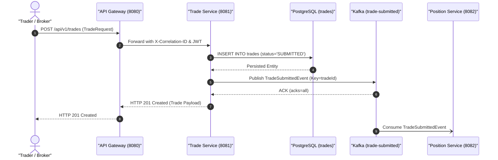
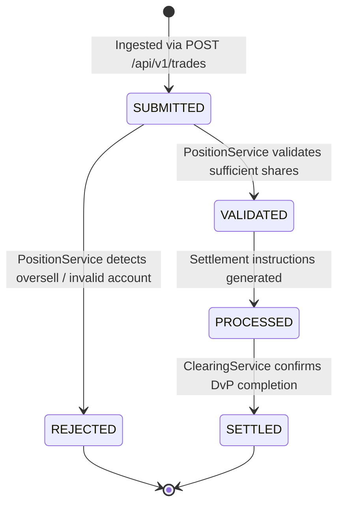

# 🏛️ Trade Service Architecture & Technical Specification

> **Component:** `trade-service`  
> **Author & Architect:** Pulkit Mathur ([@Pulkit1822](https://github.com/Pulkit1822))  
> **Port:** `8081` | **Base Package:** `com.clearing.trade`  
> **Runtime:** Java 21 LTS | Spring Boot 3.3.0 | PostgreSQL 16 | Apache Kafka  

---

## 1. Executive Summary & Purpose

The **Trade Service** acts as the high-throughput ingestion engine and authoritative system of record for matched trades within the Clearing and Settlement platform. In modern institutional financial markets, executed orders from electronic exchanges, crossing networks, or bilateral OTC counterparties require immediate, immutable recording before entering the post-trade clearing and settlement pipeline.

### Real-World Analogy
```
  Supermarket Checkout                       Trading Platform
  ─────────────────────────────────────────────────────────────────────────────
  Customer brings items to cashier    ──►  Broker submits matched trade order
  Cashier scans & prints paper bill   ──►  Trade Service records trade in PostgreSQL
  Receipt handed to inventory/packer  ──►  Kafka event (trade-submitted) emitted to ledger
```

> **In simple terms:** When a broker or matching engine completes an order (e.g., Buyer buys 100 AAPL from Seller @ $182.50), the Trade Service validates the format, assigns an immutable trade ID, persists it with status `SUBMITTED`, and kicks off the post-trade clearing lifecycle.

---

## 2. Platform Topology & Pipeline Integration

The Trade Service represents the entry gate of the event-driven clearing pipeline:



---

## 3. Concrete Numerical Example Walkthrough

### Scenario: Matched Execution of 100 AAPL @ $182.50

```
  Trade Details:
  ├── Instrument:       AAPL (Apple Inc.)
  ├── Buyer Account:    ACC-BUYER-001
  ├── Seller Account:   ACC-SELLER-002
  ├── Quantity:         100 Shares
  ├── Execution Price:  $182.50 per share
  └── Total Value:      100 × $182.50 = $18,250.00 USD
```

### Step-by-Step Execution:
1. **Client Submits Request**: Broker sends HTTP `POST /api/v1/trades` with payload:
   ```json
   {
     "instrumentId": "AAPL",
     "buyerAccountId": "ACC-BUYER-001",
     "sellerAccountId": "ACC-SELLER-002",
     "quantity": 100,
     "price": 182.50
   }
   ```
2. **Schema & Bean Validation**: Spring MVC checks `@Valid`. Confirms `quantity >= 1` and `price >= 0.01`.
3. **Entity Creation**: Trade Service assigns a new UUID `c89b0d39-6cb4-49c2-9e95-728b78f44ff5` and timestamps `tradeDate = Instant.now()`.
4. **PostgreSQL Persistence**: Inserts row into `trades` table:
   ```sql
   INSERT INTO trades (id, buyer_account_id, seller_account_id, instrument_id, quantity, price, trade_date, status, created_at, updated_at)
   VALUES ('c89b0d39-6cb4-49c2-9e95-728b78f44ff5', 'ACC-BUYER-001', 'ACC-SELLER-002', 'AAPL', 100.0000, 182.5000, NOW(), 'SUBMITTED', NOW(), NOW());
   ```
5. **Kafka Publication**: Emits `TradeSubmittedEvent` to Kafka topic `trade-submitted` with key `c89b0d39-6cb4-49c2-9e95-728b78f44ff5`.
6. **Client Receipt**: Responds with `201 Created` in under 8ms. Downstream position validation happens asynchronously.

---

## 4. Class Hierarchy & Architectural Structure

```
trade-service/
└── src/main/java/com/clearing/trade/
    │
    ├── TradeServiceApplication.java           ← Spring Boot 3 bootstrap entry point
    │
    ├── controller/
    │   └── TradeController.java               ← HTTP REST Controller (/api/v1/trades)
    │
    ├── service/
    │   └── TradeProcessingService.java        ← Transactional boundary, entity generation & publishing
    │
    ├── repository/
    │   └── TradeRepository.java               ← Spring Data JPA repository for 'trades' table
    │
    ├── model/
    │   ├── Trade.java                         ← JPA Entity mapping to PostgreSQL 'trades'
    │   └── TradeStatus.java                   ← Lifecycle state machine enum
    │
    └── kafka/
        └── TradeEventPublisher.java           ← Idempotent Kafka producer for 'trade-submitted'
```

---

## 5. Classes Explained with Line-by-Line Code Breakdown

### 5.1 TradeController (`controller/TradeController.java`)

```java
@RestController
@RequestMapping("/api/v1/trades")
public class TradeController {

    private final TradeProcessingService tradeProcessingService;

    public TradeController(TradeProcessingService tradeProcessingService) {
        this.tradeProcessingService = tradeProcessingService;
    }

    @PostMapping
    public ResponseEntity<Trade> submitTrade(@Valid @RequestBody TradeRequest request) {
        log.info("Received HTTP POST /api/v1/trades - incoming trade execution for instrument [{}]", request.instrumentId());
        Trade savedTrade = tradeProcessingService.processTradeRequest(request);
        return ResponseEntity.status(HttpStatus.CREATED).body(savedTrade);
    }
}
```

| Line / Element | Architectural Purpose |
|---|---|
| `@RestController` | Marks class as a Spring REST component returning JSON serialized responses. |
| `@RequestMapping("/api/v1/trades")` | Enforces enterprise versioned URI namespace (`/api/v1/trades`). |
| `@Valid @RequestBody TradeRequest` | Deserializes incoming JSON body and executes Bean Validation annotations (`@NotNull`, `@Min`). |
| `tradeProcessingService.processTradeRequest()` | Delegates execution to the transactional service layer; keeps controller ultra-thin. |
| `ResponseEntity.status(HttpStatus.CREATED)` | Returns standard HTTP `201 Created` status code with the persisted entity payload. |

---

### 5.2 TradeProcessingService (`service/TradeProcessingService.java`)

```java
@Service
public class TradeProcessingService {

    private final TradeRepository tradeRepository;
    private final TradeEventPublisher tradeEventPublisher;

    @Transactional
    public Trade processTradeRequest(TradeRequest request) {
        // 1. Construct JPA Entity
        Trade newTrade = new Trade(
                UUID.randomUUID(), 
                request.buyerAccountId(), 
                request.sellerAccountId(), 
                request.instrumentId(),
                new BigDecimal(request.quantity()),
                request.price(),
                Instant.now(),
                TradeStatus.SUBMITTED
        );

        // 2. Persist to PostgreSQL database
        Trade savedTrade = tradeRepository.save(newTrade);

        // 3. Publish Kafka Event
        TradeSubmittedEvent event = new TradeSubmittedEvent(
                savedTrade.getId().toString(),
                savedTrade.getBuyerAccountId(),
                savedTrade.getSellerAccountId(),
                savedTrade.getInstrumentId(),
                savedTrade.getQuantity().intValue(),
                savedTrade.getPrice(),
                savedTrade.getTradeDate()
        );
        tradeEventPublisher.publishTradeSubmitted(event);

        return savedTrade;
    }
}
```

| Step | Operation | Technical Explanation |
|---|---|---|
| `@Transactional` | Transaction Boundary | Ensures DB persist and Kafka dispatch are tightly coupled. If an unhandled exception occurs, the DB transaction rolls back cleanly. |
| `UUID.randomUUID()` | Idempotent Primary Key | Generates a collision-free UUID v4 identifier for the trade lifecycle. |
| `tradeRepository.save()` | Synchronous DB Write | Commits row to PostgreSQL `trades` table. |
| `publishTradeSubmitted()` | Kafka Publish | Sends `TradeSubmittedEvent` to `trade-submitted` topic with `acks=all` idempotence. |

---

### 5.3 Trade Entity & State Lifecycle

```java
@Entity
@Table(name = "trades")
public class Trade {
    @Id
    @Column(columnDefinition = "UUID", updatable = false, nullable = false)
    private UUID id;

    @Column(name = "buyer_account_id", nullable = false, length = 50)
    private String buyerAccountId;

    @Column(name = "seller_account_id", nullable = false, length = 50)
    private String sellerAccountId;

    @Column(name = "instrument_id", nullable = false, length = 50)
    private String instrumentId;

    @Column(precision = 19, scale = 4, nullable = false)
    private BigDecimal quantity;

    @Column(precision = 19, scale = 4, nullable = false)
    private BigDecimal price;

    @Column(name = "trade_date", nullable = false)
    private Instant tradeDate;

    @Enumerated(EnumType.STRING)
    @Column(nullable = false, length = 30)
    private TradeStatus status;
}
```

#### Database Table Representation (`trades`)
```
┌──────────────────────────────────────┬─────────────────┬──────────────────┬──────────────┬──────────┬──────────┬───────────┐
│ id                                   │ buyer_account   │ seller_account   │ instrument   │ quantity │  price   │  status   │
├──────────────────────────────────────┼─────────────────┼──────────────────┼──────────────┼──────────┼──────────┼───────────┤
│ c89b0d39-6cb4-49c2-9e95-728b78f44ff5 │ ACC-BUYER-001   │ ACC-SELLER-002   │ AAPL         │ 100.0000 │ 182.5000 │ SUBMITTED │
│ f47ac10b-58cc-4372-a567-0e02b2c3d479 │ ACC-BUYER-003   │ ACC-SELLER-001   │ TSLA         │  50.0000 │ 210.2500 │ SETTLED   │
└──────────────────────────────────────┴─────────────────┴──────────────────┴──────────────┴──────────┴──────────┴───────────┘
```

#### Lifecycle State Machine


---

## 6. Architecture Comparison: Direct HTTP vs Event-Driven (Kafka)

### Traditional Direct HTTP Architecture
```
  [Client] ──HTTP──► [Trade Service] ──HTTP──► [Position Service] ──HTTP──► [Clearing Service]
```
- **Flaws**:
  - **Cascading Failures**: If Position Service or Clearing Service is down or slow, Trade Service blocks and times out.
  - **Latency Spike**: Trade submission response time equals the sum of all downstream network calls (>500ms).
  - **Tight Coupling**: Trade Service must know the network location and health of every downstream service.

### Event-Driven Kafka Architecture (Our Platform)
```
  [Client] ──HTTP──► [Trade Service] ──► [PostgreSQL]
                            │
                            └──Kafka Topic: trade-submitted
                                     ├──► [Position Service]
                                     └──► [Audit / Analytics]
```
| Architectural Metric | Traditional Direct HTTP | Event-Driven (Our System) |
|---|---|---|
| **Response Latency** | High (500ms - 2000ms) | Ultra-Low (< 10ms) |
| **System Availability** | Vulnerable (1 service down = entire pipeline down) | High (Downstream services catch up from Kafka log) |
| **Backpressure Control** | Poor (Threads exhaust, HTTP 504 errors) | Natural (Kafka buffers bursts up to millions of events) |
| **Scalability** | Complex distributed orchestration | Independent consumer group scaling |

---

## 7. Staff-Level Interview Questions & Deep Dives

### Q1: Why separate Trade Service from Clearing Service and Position Service?
> **Answer:** The Single Responsibility Principle (SRP) and operational fault tolerance. Trade Service's sole responsibility is **fast, durable trade intake and recording**. By isolating it, we guarantee that brokers can always submit executions even if the clearing engine is performing a heavy batch settlement or corporate action calculation.

### Q2: Why use Kafka instead of synchronous REST between Trade Service and Position Service?
> **Answer:** Asynchronous decoupling and guaranteed delivery. Trade intake requires sub-10ms response times. Performing real-time balance checks and database row-level locking synchronously inside the trade submission HTTP thread would create extreme thread pool contention. Kafka acts as an immutable, high-throughput shock absorber.

### Q3: How do you prevent duplicate trade submissions (Idempotency)?
> **Answer:** We enforce idempotency at multiple levels:
> 1. At the API Gateway, requests carry a unique `X-Correlation-ID`.
> 2. At the Trade Service database layer, a unique constraint on `id` (or external execution reference) rejects duplicates at the database level.
> 3. In Kafka, the producer operates with `enable.idempotence=true`, guaranteeing exactly-once delivery at the broker partition layer.

### Q4: What happens if Kafka fails while persisting to PostgreSQL?
> **Answer:** The `@Transactional` annotation ensures atomicity. If Kafka broker acknowledgment fails with an exception, the Spring transaction rolls back the PostgreSQL write. The client receives an error and safely retries. For enterprise scaling, this can be upgraded to the Transactional Outbox pattern using Debezium CDC.

---

## 8. Summary & Responsibilities Matrix

```
┌─────────────────────────────────────────────────────────┐
│             TRADE SERVICE — RESPONSIBILITIES            │
│  ✔  Accept incoming trade orders via REST API           │
│  ✔  Validate trade constraints (qty >= 1, price > 0)    │
│  ✔  Persist immutable trade record (status = SUBMITTED) │
│  ✔  Publish TradeSubmittedEvent to Kafka                │
│  ✔  Trigger post-trade lifecycle without blocking       │
└─────────────────────────────────────────────────────────┘
```