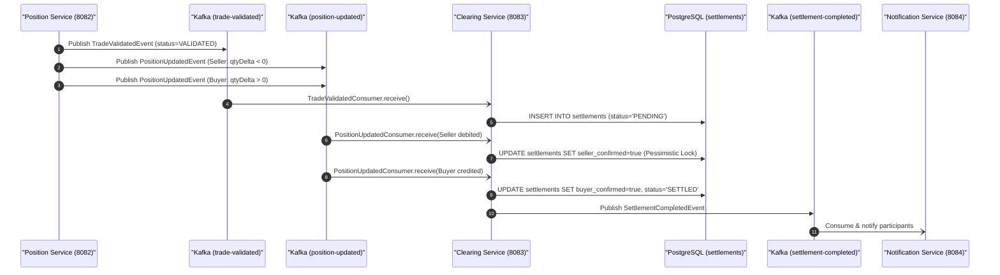

# 🏛️ Clearing Service Architecture & Technical Specification

> **Component:** `clearing-service`  
> **Author & Architect:** Pulkit Mathur ([@Pulkit1822](https://github.com/Pulkit1822))  
> **Port:** `8083` | **Base Package:** `com.clearing.clearing`  
> **Runtime:** Java 21 LTS | Spring Boot 3.3.0 | PostgreSQL 16 | Apache Kafka  

---

## 1. Executive Summary & Purpose

The **Clearing Service** is the central orchestrator of the **Delivery versus Payment (DvP)** settlement lifecycle. In modern financial market infrastructures (FMIs) governed by CPSS-IOSCO Principles, clearing ensures that trade obligations are verified, matched, and committed atomically such that the transfer of securities from seller to buyer occurs **if and only if** the transfer of funds occurs.

### Real-World Analogy
```
  Escrow / Real Estate Closing               Clearing & Settlement Platform
  ─────────────────────────────────────────────────────────────────────────────
  Buyer wires funds into Escrow       ──►  Buyer's position update confirmed
  Seller signs over deed to Escrow    ──►  Seller's position update confirmed
  Escrow verifies both sides match    ──►  Clearing Service checks both legs confirmed
  Deed & funds released simultaneously──►  Settlement marked SETTLED (DvP complete)
```

> **In simple terms:** You wouldn't hand over a $100 bill to a stranger without receiving your merchandise at the exact same time. The Clearing Service acts as the trusted escrow agent guaranteeing that neither buyer nor seller faces principal settlement risk.

---

## 2. Platform Topology & Pipeline Integration

The Clearing Service coordinates between position ledger updates and terminal notification dispatch:



---

## 3. Concrete Numerical Example Walkthrough

### Scenario: DvP Settlement of Trade `c89b0d39-6cb4-49c2-9e95-728b78f44ff5` (100 AAPL)

```
  Trade Details:
  ├── Trade ID:         c89b0d39-6cb4-49c2-9e95-728b78f44ff5
  ├── Instrument:       AAPL
  ├── Buyer Account:    ACC-BUYER-001
  ├── Seller Account:   ACC-SELLER-002
  └── Quantity:         100 Shares
```

### Step-by-Step Two-Phase Confirmation:

1. **Step 1: Validation Received**:
   - `TradeValidatedEvent` arrives with `status = VALIDATED`.
   - Clearing Service checks database: no existing settlement record found.
   - Persists new record: `status = PENDING`, `buyerConfirmed = false`, `sellerConfirmed = false`.
2. **Step 2: Seller Leg Confirmed (`quantityDelta = -100`)**:
   - `PositionUpdatedEvent` arrives from partition: `accountId = ACC-SELLER-002`, `quantityDelta = -100`.
   - `handlePositionUpdated()` acquires row-level pessimistic lock:
     ```sql
     SELECT * FROM settlements WHERE trade_id = 'c89b0d39-6cb4-49c2-9e95-728b78f44ff5' FOR UPDATE;
     ```
   - Sets `sellerConfirmed = true`.
   - Checks DvP condition: `buyerConfirmed (false) && sellerConfirmed (true)` ➔ Not yet settled. Saves state.
3. **Step 3: Buyer Leg Confirmed (`quantityDelta = +100`)**:
   - `PositionUpdatedEvent` arrives from partition: `accountId = ACC-BUYER-001`, `quantityDelta = +100`.
   - Acquires row-level pessimistic lock.
   - Sets `buyerConfirmed = true`.
   - Checks DvP condition: `buyerConfirmed (true) && sellerConfirmed (true)` ➔ **DvP Satisfied!**
   - Updates status: `status = SETTLED`, `settledAt = NOW()`.
4. **Step 4: Terminal Event Published**:
   - Emits `SettlementCompletedEvent` to `settlement-completed`. Notification Service catches event and alerts participants.

---

## 4. Class Hierarchy & Architectural Structure

```
clearing-service/
└── src/main/java/com/clearing/clearing/
    │
    ├── ClearingServiceApplication.java          ← Spring Boot 3 entry point
    │
    ├── controller/
    │   └── ClearingController.java              ← REST API endpoints (/api/v1/clearing)
    │
    ├── service/
    │   └── ClearingService.java                 ← Core settlement state machine logic
    │
    ├── repository/
    │   └── SettlementRepository.java            ← JPA repo with pessimistic row-locking queries
    │
    ├── model/
    │   ├── Settlement.java                      ← JPA Entity representing settlement state
    │   └── SettlementStatus.java                ← Enum: PENDING, SETTLED, FAILED
    │
    └── kafka/
        ├── TradeValidatedConsumer.java          ← Consumes: trade-validated
        ├── PositionUpdatedConsumer.java         ← Consumes: position-updated
        └── SettlementEventPublisher.java        ← Publishes: settlement-completed
```

---

## 5. Classes Explained with Line-by-Line Code Breakdown

### 5.1 ClearingController (`controller/ClearingController.java`)

```java
@RestController
@RequestMapping("/api/v1/clearing")
public class ClearingController {

    private final ClearingService clearingService;

    public ClearingController(ClearingService clearingService) {
        this.clearingService = clearingService;
    }

    @GetMapping("/{tradeId}")
    public ResponseEntity<Settlement> getSettlementByTradeId(@PathVariable String tradeId) {
        return clearingService.findByTradeId(tradeId)
                .map(ResponseEntity::ok)
                .orElse(ResponseEntity.notFound().build());
    }

    @GetMapping
    public ResponseEntity<List<Settlement>> getSettlementsByStatus(
            @RequestParam(required = false) SettlementStatus status) {
        List<Settlement> settlements = status != null
                ? clearingService.findByStatus(status)
                : clearingService.findAll();
        return ResponseEntity.ok(settlements);
    }
}
```

| Line / Element | Architectural Purpose |
|---|---|
| `@RequestMapping("/api/v1/clearing")` | Canonical REST base path for clearing operations. |
| `getSettlementByTradeId()` | Exposes single trade settlement lookup for trade confirmation checks. |
| `Optional.map(ResponseEntity::ok)` | Idiomatic Spring response: returns `200 OK` with body if present, or `404 Not Found`. |
| `getSettlementsByStatus()` | Facilitates operations dashboard filtering (e.g., finding all `PENDING` or `FAILED` settlements). |

---

### 5.2 ClearingService Core DvP Engine (`service/ClearingService.java`)

```java
@Service
public class ClearingService {

    private final SettlementRepository settlementRepository;
    private final SettlementEventPublisher settlementEventPublisher;

    @Transactional
    public void handleTradeValidated(TradeValidatedEvent event) {
        // Idempotency: skip if already registered
        if (settlementRepository.findByTradeId(event.tradeId()).isPresent()) {
            return;
        }

        // Handle oversell / validation rejection
        if (event.status() == TradeValidationStatus.REJECTED) {
            Settlement failed = new Settlement(UUID.randomUUID(), event.tradeId(), SettlementStatus.FAILED);
            failed.setFailureReason(event.rejectionReason());
            settlementRepository.save(failed);
            return;
        }

        // Initialize pending bilateral settlement
        Settlement pending = new Settlement(UUID.randomUUID(), event.tradeId(), SettlementStatus.PENDING);
        settlementRepository.save(pending);
    }

    @Transactional
    public void handlePositionUpdated(PositionUpdatedEvent event) {
        // Row lock prevents concurrent buyer and seller updates from colliding
        Settlement settlement = settlementRepository.findByTradeId(event.tradeId())
                .orElseGet(() -> new Settlement(UUID.randomUUID(), event.tradeId(), SettlementStatus.PENDING));

        if (settlement.getStatus() == SettlementStatus.SETTLED || settlement.getStatus() == SettlementStatus.FAILED) {
            return; // Terminal state guard
        }

        // Identify which leg was confirmed
        if (event.quantityDelta() > 0) {
            settlement.setBuyerConfirmed(true);
        } else if (event.quantityDelta() < 0) {
            settlement.setSellerConfirmed(true);
        }

        // DvP Check: Both legs must be confirmed
        if (Boolean.TRUE.equals(settlement.getBuyerConfirmed()) && 
            Boolean.TRUE.equals(settlement.getSellerConfirmed())) {
            settlement.setStatus(SettlementStatus.SETTLED);
            settlement.setSettledAt(Instant.now());
            settlementRepository.save(settlement);

            settlementEventPublisher.publishSettlementCompleted(
                new SettlementCompletedEvent(settlement.getTradeId(), event.accountId(), null, settlement.getSettledAt())
            );
        } else {
            settlementRepository.save(settlement);
        }
    }
}
```

| Method / Step | Technical Detail |
|---|---|
| `handleTradeValidated()` | Initial handshake. Creates `PENDING` settlement row or marks `FAILED` if seller lacked stock. |
| `handlePositionUpdated()` | Consumes position events from Kafka. Checks signed `quantityDelta` to tag buyer or seller leg. |
| `findByTradeId()` Row Lock | Uses `LockModeType.PESSIMISTIC_WRITE` (`SELECT ... FOR UPDATE`), preventing lost update bugs. |
| `DvP Verification` | Asserts `buyerConfirmed && sellerConfirmed`. Guarantees zero uncollateralized asset delivery. |

---

### 5.3 Database Entity & Table Representation (`settlements`)

```
┌──────────────────────────────────────┬──────────────────────────────────────┬──────────┬───────────┬───────────┬──────────────────────────┐
│ id                                   │ trade_id                             │ status   │ buyer_ack │ seller_ack│ settled_at               │
├──────────────────────────────────────┼──────────────────────────────────────┼──────────┼───────────┼───────────┼──────────────────────────┤
│ f47ac10b-58cc-4372-a567-0e02b2c3d479 │ c89b0d39-6cb4-49c2-9e95-728b78f44ff5 │ SETTLED  │ true      │ true      │ 2026-10-25 16:30:00.840Z │
│ a1b2c3d4-e5f6-7890-abcd-ef1234567890 │ 98765432-1234-5678-90ab-cdef12345678 │ FAILED   │ false     │ false     │ NULL                     │
└──────────────────────────────────────┴──────────────────────────────────────┴──────────┴───────────┴───────────┴──────────────────────────┘
```

---

## 6. Staff-Level Interview Questions & Deep Dives

### Q1: What is Delivery versus Payment (DvP) and why is it essential?
> **Answer:** DvP is a securities settlement mechanism where the irreversible transfer of securities occurs **if and only if** the final transfer of funds occurs. Without DvP, if Party A transfers shares to Party B first, and Party B defaults before paying cash, Party A loses both securities and money (known as *principal settlement risk* or *Herstatt risk*).

### Q2: How does Clearing Service avoid race conditions during dual confirmation?
> **Answer:** Because Kafka partitions `position-updated` events by `accountId`, buyer and seller position events arrive on different partitions and are processed concurrently by separate consumer threads. In `SettlementRepository`, the query `findByTradeId` is annotated with `@Lock(LockModeType.PESSIMISTIC_WRITE)`. This translates to PostgreSQL `SELECT ... FOR UPDATE`, guaranteeing that the second thread waits until the first thread commits its flag before evaluating the DvP condition.

### Q3: What happens if a `PositionUpdatedEvent` arrives before the `TradeValidatedEvent`?
> **Answer:** Due to Kafka consumer group scheduling or network jitter, position updates might arrive a few milliseconds before the validation message. The `ClearingService` implements an `orElseGet` fallback: if no settlement record exists yet, it creates a placeholder `PENDING` record on the fly so no confirmation is ever dropped.

### Q4: How is rejection handled when a seller attempts to oversell?
> **Answer:** When `PositionService` detects `sellerQuantity < requestedQuantity`, it publishes `TradeValidatedEvent` with status `REJECTED` and reason `"Insufficient position in Seller account"`. `ClearingService` catches this, creates a `Settlement` record with status `FAILED`, records the reason, and terminates the pipeline without publishing a completion event.
