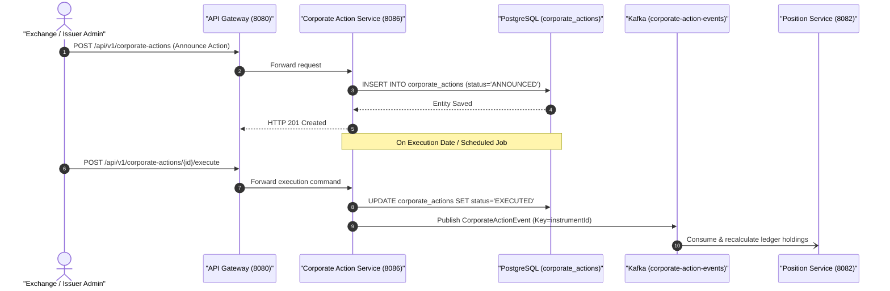

# 🏛️ Corporate Action Service Architecture & Technical Specification

> **Component:** `corporate-action-service`  
> **Author & Architect:** Pulkit Mathur ([@Pulkit1822](https://github.com/Pulkit1822))  
> **Port:** `8086` | **Base Package:** `com.clearing.corporate`  
> **Runtime:** Java 21 LTS | Spring Boot 3.3.0 | PostgreSQL 16 | Apache Kafka  

---

## 1. Executive Summary & Purpose

The **Corporate Action Service** orchestrates lifecycle adjustments initiated by public companies and security issuers that impact investor holdings and portfolio valuations. In financial clearings, actions such as cash dividends, stock splits, bonus shares, and rights issues alter instrument balances independently of secondary market trading.

### Real-World Analogies & Types
```
  Corporate Action Type   Real-World Analogy                       Portfolio Impact
  ──────────────────────────────────────────────────────────────────────────────────────────
  STOCK_SPLIT (2:1)       Slicing an 8-slice pizza into 16 slices  Twice the shares, half the price
  DIVIDEND ($2/share)     Landlord paying out rental profit        Cash credit per share owned
  BONUS_ISSUE (1:1)       "Buy 1, Get 1 Free" loyalty bonus        Free additional shares issued
  RIGHTS_ISSUE            VIP discount ticket for new shares       Pre-emptive purchase entitlement
```

> **In simple terms:** Corporate actions occur when a company decides to reward shareholders or alter its capital structure. They do not originate from a buyer and seller trading on an exchange, but from the issuing company itself.

---

## 2. Platform Topology & Pipeline Integration

Corporate actions originate from regulatory announcements, progress through an announcement phase, and execute on the ex-date:



---

## 3. Concrete Numerical Examples

### Example A: 2-for-1 Stock Split on AAPL (`STOCK_SPLIT`)
```
  Event Parameters:
  ├── Instrument:     AAPL
  ├── Action Type:    STOCK_SPLIT
  ├── Split Factor:   2.0
  └── Record Date:    2026-11-01

  Investor Position Impact:
  ├── Pre-Split Holdings:   100 Shares @ $180.00 = $18,000.00
  ├── Split Calculation:    100 × 2.0 = 200 Shares
  ├── Adjusted Share Price: $180.00 ÷ 2.0 = $90.00
  └── Post-Split Holdings:  200 Shares @ $90.00 = $18,000.00 (Total value preserved)
```

### Example B: Cash Dividend of $2.50 per Share on TSLA (`DIVIDEND`)
```
  Event Parameters:
  ├── Instrument:     TSLA
  ├── Action Type:    DIVIDEND
  ├── Payout Rate:    $2.50 per share
  └── Record Date:    2026-11-05

  Investor Position Impact:
  ├── Share Holdings:       400 Shares
  ├── Payout Calculation:   400 × $2.50 = $1,000.00 USD
  └── Action Result:        $1,000.00 credited to investor's cash settlement account
```

---

## 4. Class Hierarchy & Architectural Structure

```
corporate-action-service/
└── src/main/java/com/clearing/corporate/
    │
    ├── CorporateActionServiceApplication.java      ← Spring Boot 3 bootstrap
    │
    ├── controller/
    │   └── CorporateActionController.java          ← REST endpoints (/api/v1/corporate-actions)
    │
    ├── service/
    │   └── CorporateActionService.java             ← Action lifecycle management & execution
    │
    ├── repository/
    │   └── CorporateActionRepository.java          ← PostgreSQL JPA repository
    │
    ├── model/
    │   ├── CorporateAction.java                    ← JPA Entity
    │   └── CorporateActionStatus.java              ← State enum: ANNOUNCED, PENDING, EXECUTED, CANCELLED
    │
    └── kafka/
        └── CorporateActionEventPublisher.java      ← Publishes to 'corporate-action-events'
```

---

## 5. Classes Explained with Line-by-Line Code Breakdown

### 5.1 CorporateActionController (`controller/CorporateActionController.java`)

```java
@RestController
@RequestMapping("/api/v1/corporate-actions")
public class CorporateActionController {

    private final CorporateActionService corporateActionService;

    @PostMapping
    public ResponseEntity<CorporateAction> createAction(@RequestBody CorporateAction action) {
        CorporateAction created = corporateActionService.createAction(action);
        return ResponseEntity.status(HttpStatus.CREATED).body(created);
    }

    @PostMapping("/{id}/execute")
    public ResponseEntity<CorporateAction> executeAction(@PathVariable UUID id) {
        CorporateAction executed = corporateActionService.executeAction(id);
        return ResponseEntity.ok(executed);
    }
}
```

| Line / Element | Architectural Purpose |
|---|---|
| `@RequestMapping("/api/v1/corporate-actions")` | Root namespace for corporate actions API. |
| `createAction()` | Ingests new corporate action announcements from market operators. |
| `executeAction()` | Triggers execution logic, updates state to `EXECUTED`, and publishes Kafka events. |

---

### 5.2 CorporateActionService (`service/CorporateActionService.java`)

```java
@Service
public class CorporateActionService {

    private final CorporateActionRepository repository;
    private final CorporateActionEventPublisher eventPublisher;

    @Transactional
    public CorporateAction executeAction(UUID id) {
        CorporateAction action = repository.findById(id)
                .orElseThrow(() -> new IllegalArgumentException("Action not found: " + id));

        if (action.getStatus() == CorporateActionStatus.EXECUTED) {
            return action; // Idempotent guard
        }

        action.setStatus(CorporateActionStatus.EXECUTED);
        CorporateAction saved = repository.save(action);

        CorporateActionEvent event = new CorporateActionEvent(
                saved.getId().toString(),
                saved.getInstrumentId(),
                saved.getActionType(),
                saved.getFactor(),
                Instant.now()
        );
        eventPublisher.publishCorporateAction(event);

        return saved;
    }
}
```

| Step | Operation | Technical Explanation |
|---|---|---|
| `findById()` | Entity Retrieval | Fetches action parameters from PostgreSQL. |
| `Idempotent Guard` | Duplicate Execution Check | Prevents applying the same split or dividend multiple times if called repeatedly. |
| `setStatus(EXECUTED)` | State Transition | Moves action status from `ANNOUNCED` to `EXECUTED`. |
| `publishCorporateAction()` | Kafka Dispatch | Sends `CorporateActionEvent` to `corporate-action-events` with key `instrumentId`. |

---

## 6. Database Table Representation (`corporate_actions`)

```
┌──────────────────────────────────────┬────────────┬─────────────┬──────────┬──────────────────────────┬───────────┐
│ id                                   │ instrument │ action_type │ factor   │ execution_date           │  status   │
├──────────────────────────────────────┼────────────┼─────────────┼──────────┼──────────────────────────┼───────────┤
│ a1b2c3d4-e5f6-7890-abcd-ef1234567890 │ AAPL       │ STOCK_SPLIT │   2.0000 │ 2026-11-02 00:00:00.000Z │ ANNOUNCED │
│ f9e8d7c6-b5a4-3210-9876-543210fedcba │ TSLA       │ DIVIDEND    │   2.5000 │ 2026-11-05 00:00:00.000Z │ EXECUTED  │
└──────────────────────────────────────┴────────────┴─────────────┴──────────┴──────────────────────────┴───────────┘
```

---

## 7. Staff-Level Interview Questions & Deep Dives

### Q1: What is the difference between a mandatory and a voluntary corporate action?
> **Answer:** 
> - **Mandatory Action**: Automatically applied to all shareholders without choice (e.g. Stock Split, Cash Dividend). The platform automatically recalculates positions on the ex-date.
> - **Voluntary Action**: Requires explicit shareholder election or instructions (e.g. Rights Issue subscription, Tender Offer). The platform must track individual participant elections before modifying balances.

### Q2: Why is `instrumentId` used as the Kafka partition key for corporate actions?
> **Answer:** Kafka maintains ordering on a per-partition basis. Because a corporate action (like a 2:1 split) alters holdings for all accounts holding that instrument, partitioning by `instrumentId` guarantees that downstream ledger recalculations for that stock are executed sequentially with respect to other events on the same symbol.

### Q3: How is idempotency guaranteed when applying corporate actions?
> **Answer:** The service checks `action.getStatus() == CorporateActionStatus.EXECUTED`. If the execution job is retried or executed across multiple nodes, the second invocation exits early without modifying records or emitting duplicate Kafka messages.
