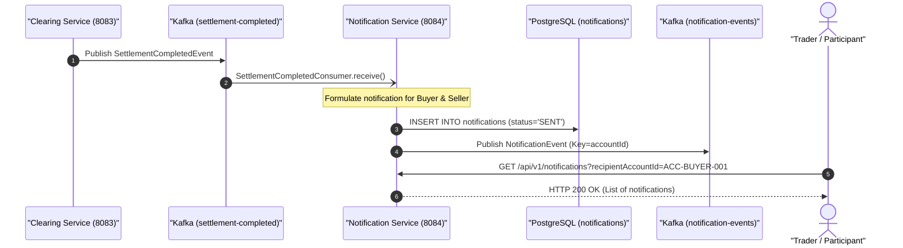

# 🏛️ Notification Service Architecture & Technical Specification

> **Component:** `notification-service`  
> **Author & Architect:** Pulkit Mathur ([@Pulkit1822](https://github.com/Pulkit1822))  
> **Port:** `8084` | **Base Package:** `com.clearing.notification`  
> **Runtime:** Java 21 LTS | Spring Boot 3.3.0 | PostgreSQL 16 | Apache Kafka  

---

## 1. Executive Summary & Purpose

The **Notification Service** is the centralized messaging and alerting hub of the Clearing and Settlement platform. It ensures institutional participants, trading desks, and compliance officers receive instant, auditable confirmations whenever post-trade lifecycle milestones occur.

### Real-World Analogy
```
  E-Commerce Delivery Tracking               Post-Trade Clearing Platform
  ─────────────────────────────────────────────────────────────────────────────
  Warehouse packs item & prints label ──►  Clearing Service settles DvP transaction
  Logistics system sends SMS alert    ──►  Notification Service consumes event
  "Your package has been delivered!"  ──►  "Your 100 AAPL trade has settled!"
```

> **In simple terms:** Instead of every microservice trying to format emails or send WebSocket alerts directly, they emit Kafka events. The Notification Service centralizes templating, dispatch, retry handling, and audit logging.

---

## 2. Platform Topology & Pipeline Integration



---

## 3. Concrete Numerical Examples

### Example A: Successful Settlement Notice (Trade `c89b0d39-6cb4-49c2-9e95-728b78f44ff5`)
```
  Settlement Parameters:
  ├── Trade ID:       c89b0d39-6cb4-49c2-9e95-728b78f44ff5
  ├── Instrument:     AAPL
  ├── Quantity:       100 Shares
  ├── Buyer Account:  ACC-BUYER-001
  └── Seller Account: ACC-SELLER-002

  Generated Notifications:
  ├── Buyer Notice (ACC-BUYER-001):
  │   "Settlement finalized for Trade [c89b0d39-6cb4-49c2-9e95-728b78f44ff5]. 100 shares of AAPL credited to your account."
  └── Seller Notice (ACC-SELLER-002):
      "Settlement finalized for Trade [c89b0d39-6cb4-49c2-9e95-728b78f44ff5]. 100 shares of AAPL debited. Proceeds credited."
```

### Example B: Trade Rejection Alert (Oversell on TSLA)
```
  Rejection Parameters:
  ├── Trade ID:       98765432-1234-5678-90ab-cdef12345678
  ├── Seller Account: ACC-SELLER-002
  └── Reason:         "Insufficient position in Seller account"

  Generated Alert:
  └── "Trade [98765432-1234-5678-90ab-cdef12345678] REJECTED by clearing house. Reason: Insufficient position in Seller account."
```

---

## 4. Class Hierarchy & Architectural Structure

```
notification-service/
└── src/main/java/com/clearing/notification/
    │
    ├── NotificationServiceApplication.java       ← Spring Boot 3 entry point
    │
    ├── controller/
    │   └── NotificationController.java           ← REST endpoints (/api/v1/notifications)
    │
    ├── service/
    │   └── NotificationService.java              ← Message generation, dispatch & DB save
    │
    ├── repository/
    │   └── NotificationRepository.java           ← JPA repo for 'notifications' table
    │
    ├── model/
    │   ├── Notification.java                     ← JPA Entity
    │   └── NotificationStatus.java               ← Enum: PENDING, SENT, FAILED
    │
    └── kafka/
        ├── SettlementCompletedConsumer.java      ← Listens to 'settlement-completed'
        └── NotificationEventPublisher.java       ← Publishes to 'notification-events'
```

---

## 5. Classes Explained with Line-by-Line Code Breakdown

### 5.1 NotificationController (`controller/NotificationController.java`)

```java
@RestController
@RequestMapping("/api/v1/notifications")
public class NotificationController {

    private final NotificationService notificationService;

    @GetMapping
    public ResponseEntity<List<Notification>> getNotifications(
            @RequestParam(required = false) String recipientAccountId,
            @RequestParam(required = false) NotificationStatus status) {
        List<Notification> result = notificationService.findNotifications(recipientAccountId, status);
        return ResponseEntity.ok(result);
    }
}
```

| Line / Element | Architectural Purpose |
|---|---|
| `@RequestMapping("/api/v1/notifications")` | Canonical REST base path for participant messaging. |
| `getNotifications()` | Allows web UI and participant portals to fetch historical transaction alerts. |
| `findNotifications()` | Flexible filter supporting query by account ID or status (`SENT`, `FAILED`). |

---

### 5.2 NotificationService (`service/NotificationService.java`)

```java
@Service
public class NotificationService {

    private final NotificationRepository repository;
    private final NotificationEventPublisher eventPublisher;

    @Transactional
    public void processSettlementCompleted(SettlementCompletedEvent event) {
        String message = String.format("Settlement finalized for Trade [%s].", event.tradeId());

        // 1. Persist notification record for Buyer
        Notification notification = new Notification(
                UUID.randomUUID(),
                event.buyerAccount(),
                "EMAIL",
                message,
                NotificationStatus.SENT,
                Instant.now()
        );
        repository.save(notification);

        // 2. Publish terminal NotificationEvent to Kafka
        eventPublisher.publishNotificationEvent(new NotificationEvent(
                event.buyerAccount(),
                event.tradeId(),
                message,
                Instant.now()
        ));
    }
}
```

| Step | Operation | Technical Explanation |
|---|---|---|
| `String.format()` | Message Formatting | Converts technical event into a human-readable confirmation message. |
| `repository.save()` | Audit Logging | Persists the notification row into PostgreSQL `notifications` table. |
| `publishNotificationEvent()` | Stream Event | Dispatches `NotificationEvent` to `notification-events` for monitoring log aggregators. |

---

## 6. Database Table Representation (`notifications`)

```
┌──────────────────────────────────────┬─────────────────┬─────────┬────────────────────────────────────────────────────────┬────────┬──────────────────────────┐
│ id                                   │ recipient_acc   │ channel │ message                                                │ status │ sent_at                  │
├──────────────────────────────────────┼─────────────────┼─────────┼────────────────────────────────────────────────────────┼────────┼──────────────────────────┤
│ e987c654-3210-4abc-def0-123456789abc │ ACC-BUYER-001   │ EMAIL   │ Settlement finalized for Trade [c89b0d39-6cb4...].     │ SENT   │ 2026-10-25 16:30:01.050Z │
│ 12345678-abcd-ef01-2345-6789abcdef01 │ ACC-SELLER-002  │ EMAIL   │ Settlement finalized for Trade [c89b0d39-6cb4...].     │ SENT   │ 2026-10-25 16:30:01.050Z │
└──────────────────────────────────────┴─────────────────┴─────────┴────────────────────────────────────────────────────────┴────────┴──────────────────────────┘
```

---

## 7. Staff-Level Interview Questions & Deep Dives

### Q1: Why decouple notifications into a separate microservice?
> **Answer:** Latency and resilience isolation. Sending emails, push notifications, or Webhooks involves variable third-party latencies (50ms - 5000ms). If `TradeService` or `ClearingService` sent notifications synchronously, a slow SMTP server or SMS gateway would freeze clearing pipelines and exhaust database connection pools.

### Q2: How does the Notification Service handle high throughput during market opens?
> **Answer:** Kafka naturally buffers high volumes of `SettlementCompletedEvent`s. The `NotificationService` consumer group scales horizontally across partitions. If email sending becomes a bottleneck, messages are queued in the database and processed asynchronously by worker pools without slowing down post-trade clearing.

### Q3: Why is `NotificationEvent` emitted if Notification Service is the last step?
> **Answer:** Observability and compliance. In institutional trading, regulatory bodies (e.g., SEC Rule 10b-10 in the US or MiFID II in Europe) require proof that confirmations were dispatched. Emitting `NotificationEvent` into an immutable Kafka topic allows compliance archiving and SIEM security monitoring tools to index confirmation receipts.
