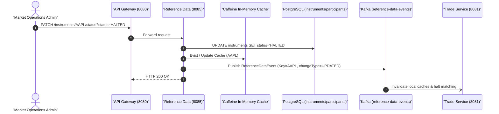

# 🏛️ Reference Data Service Architecture & Technical Specification

> **Component:** `reference-data-service`  
> **Author & Architect:** Pulkit Mathur ([@Pulkit1822](https://github.com/Pulkit1822))  
> **Port:** `8085` | **Base Package:** `com.clearing.refdata`  
> **Runtime:** Java 21 LTS | Spring Boot 3.3.0 | PostgreSQL 16 | Apache Kafka | Caffeine Cache  

---

## 1. Executive Summary & Purpose

The **Reference Data Service** provides the canonical "Golden Record" for all static financial data required across the trading and clearing platform. By acting as the centralized authority for security definitions, lot sizes, tick sizes, and participant operational eligibility, it ensures that every microservice operates against consistent, audited reference parameters.

### Real-World Analogy
```
  Airport Flight Information Board           Reference Data Service
  ─────────────────────────────────────────────────────────────────────────────
  Central board lists all active flights ──► Single source of truth for all instruments
  Gate agents check boarding pass rules  ──► Services check lot size & tick size rules
  Flight status changed to "DELAYED"     ──► Instrument status changed to "HALTED"
```

> **In simple terms:** You cannot trade a stock that the exchange doesn't know exists, or trade with a broker whose membership is suspended. The Reference Data Service maintains this master directory.

---

## 2. Platform Topology & Pipeline Integration



---

## 3. Concrete Numerical Examples

### Example A: Golden Instrument Record (`AAPL`)
```
  Instrument Specifications:
  ├── Instrument ID:   AAPL
  ├── Symbol:          AAPL
  ├── Full Name:       Apple Inc. Common Stock
  ├── Asset Class:     EQUITY
  ├── Base Currency:   USD
  ├── Tick Size:       $0.0100 (Minimum price increment)
  ├── Lot Size:        1 Share (Minimum tradable unit)
  └── Status:          ACTIVE

  Validation Rules Enforced:
  ├── Price $182.50:   VALID ($182.50 is an exact multiple of 0.01)
  ├── Price $182.505:  INVALID (Fractional cent violates $0.01 tick size)
  └── Quantity 100:    VALID (Exact multiple of lot size 1)
```

### Example B: Clearing Participant Record (`ACC-BUYER-001`)
```
  Participant Profile:
  ├── Participant ID:  ACC-BUYER-001
  ├── Legal Name:      Apex Clearing Corporation
  ├── Type:            CLEARING_MEMBER
  ├── BIC / SWIFT:     APEXUS33XXX
  └── Status:          ACTIVE

  Eligibility Check:
  ├── If Status == ACTIVE:     Trade execution and clearing permitted.
  └── If Status == SUSPENDED:  All trade submissions immediately blocked at Gateway.
```

---

## 4. Class Hierarchy & Architectural Structure

```
reference-data-service/
└── src/main/java/com/clearing/refdata/
    │
    ├── ReferenceDataServiceApplication.java       ← Spring Boot 3 entry point
    │
    ├── config/
    │   └── CacheConfig.java                       ← Caffeine Cache manager configuration
    │
    ├── controller/
    │   ├── InstrumentController.java              ← REST endpoints (/instruments)
    │   └── ParticipantController.java             ← REST endpoints (/participants)
    │
    ├── service/
    │   ├── InstrumentService.java                 ← Instrument business logic & caching
    │   └── ParticipantService.java                ← Participant validation & lifecycle
    │
    ├── repository/
    │   ├── InstrumentRepository.java              ← JPA repo for 'instruments' table
    │   └── ParticipantRepository.java             ← JPA repo for 'participants' table
    │
    ├── model/
    │   ├── Instrument.java                        ← Entity for financial assets
    │   ├── InstrumentStatus.java                  ← Enum: ACTIVE, HALTED, DELISTED
    │   ├── Participant.java                       ← Entity for market participants
    │   └── ParticipantStatus.java                 ← Enum: ACTIVE, SUSPENDED, INACTIVE
    │
    └── kafka/
        └── ReferenceDataEventPublisher.java       ← Publishes to 'reference-data-events'
```

---

## 5. Classes Explained with Line-by-Line Code Breakdown

### 5.1 InstrumentController (`controller/InstrumentController.java`)

```java
@RestController
@RequestMapping("/instruments")
public class InstrumentController {

    private final InstrumentService instrumentService;

    @GetMapping("/{id}")
    public ResponseEntity<Instrument> getById(@PathVariable String id) {
        return instrumentService.findById(id)
                .map(ResponseEntity::ok)
                .orElse(ResponseEntity.notFound().build());
    }

    @PatchMapping("/{id}/status")
    public ResponseEntity<Instrument> updateStatus(
            @PathVariable String id,
            @RequestParam InstrumentStatus status) {
        Instrument updated = instrumentService.updateStatus(id, status);
        return ResponseEntity.ok(updated);
    }
}
```

| Line / Element | Architectural Purpose |
|---|---|
| `@RequestMapping("/instruments")` | Master instrument catalog endpoint. |
| `getById()` | Fetches symbol metadata; served via Caffeine in-memory cache. |
| `updateStatus()` | Administrative circuit breaker allowing emergency market halts on specific stocks. |

---

### 5.2 InstrumentService with Caffeine Cache (`service/InstrumentService.java`)

```java
@Service
public class InstrumentService {

    private final InstrumentRepository repository;
    private final ReferenceDataEventPublisher eventPublisher;

    @Cacheable(value = "instruments", key = "#id")
    public Optional<Instrument> findById(String id) {
        log.info("Cache miss for instrument [{}]. Loading from PostgreSQL...", id);
        return repository.findById(id);
    }

    @Transactional
    @CacheEvict(value = "instruments", key = "#id")
    public Instrument updateStatus(String id, InstrumentStatus status) {
        Instrument instrument = repository.findById(id)
                .orElseThrow(() -> new IllegalArgumentException("Instrument not found: " + id));

        instrument.setStatus(status);
        Instrument saved = repository.save(instrument);

        eventPublisher.publishReferenceDataEvent(new ReferenceDataEvent(
                saved.getId(), "INSTRUMENT", "UPDATED", Instant.now()
        ));

        return saved;
    }
}
```

| Step | Operation | Technical Explanation |
|---|---|---|
| `@Cacheable("instruments")` | In-Memory Read | Subsequent lookups for `"AAPL"` return in `< 1ms` directly from RAM without hitting SQL. |
| `@CacheEvict` | Cache Busting | When an operator halts a stock, local memory cache is immediately cleared. |
| `publishReferenceDataEvent()` | Distributed Invalidation | Emits event so downstream service caches across other servers stay synchronized. |

---

## 6. Database Table Representations (`instruments` & `participants`)

### Table: `instruments`
```
┌──────┬────────┬──────────────────────────┬─────────────┬──────────┬───────────┬──────────┬───────────┐
│ id   │ symbol │ name                     │ asset_class │ currency │ tick_size │ lot_size │  status   │
├──────┼────────┼──────────────────────────┼─────────────┼──────────┼───────────┼──────────┼───────────┤
│ AAPL │ AAPL   │ Apple Inc. Common Stock  │ EQUITY      │ USD      │    0.0100 │        1 │ ACTIVE    │
│ TSLA │ TSLA   │ Tesla Inc. Common Stock  │ EQUITY      │ USD      │    0.0100 │        1 │ ACTIVE    │
│ BTC  │ BTC    │ Bitcoin Digital Asset    │ CRYPTO      │ USD      │    0.5000 │        1 │ ACTIVE    │
└──────┴────────┴──────────────────────────┴─────────────┴──────────┴───────────┴──────────┴───────────┘
```

### Table: `participants`
```
┌────────────────┬──────────────────────────┬─────────────────┬───────────┬─────────────┐
│ id             │ name                     │ type            │ status    │ bic_code    │
├────────────────┼──────────────────────────┼─────────────────┼───────────┼─────────────┤
│ ACC-BUYER-001  │ Apex Clearing Corp       │ CLEARING_MEMBER │ ACTIVE    │ APEXUS33XXX │
│ ACC-SELLER-002 │ Citadel Securities LLC   │ MARKET_MAKER    │ ACTIVE    │ CITAUS33XXX │
│ ACC-SUSPEND-03 │ Rogue Brokerage Ltd      │ BROKER_DEALER   │ SUSPENDED │ ROGUGB22XXX │
└────────────────┴──────────────────────────┴─────────────────┴───────────┴─────────────┘
```

---

## 7. Staff-Level Interview Questions & Deep Dives

### Q1: Why use Caffeine in-memory cache instead of querying PostgreSQL on every trade?
> **Answer:** Latency and database capacity. Validating instruments on 10,000 trades/sec would generate 10,000 read queries/sec against PostgreSQL, exhausting pool connections and spiking CPU. Caffeine caches hot symbols (AAPL, TSLA) directly in JVM memory, delivering sub-microsecond response times.

### Q2: How is cache invalidation handled across multiple microservice nodes?
> **Answer:** Cache invalidation follows the **Event-Driven Cache Invalidation pattern**. When an operator updates an instrument's status via `PATCH /instruments/{id}/status`, `InstrumentService` evicts its local Caffeine cache and publishes a `ReferenceDataEvent` to the `reference-data-events` Kafka topic. All running microservice instances consume this event and evict their local caches simultaneously.

### Q3: What is the financial purpose of Tick Size and Lot Size?
> **Answer:**
> - **Tick Size**: The minimum price movement allowed by market rules (e.g. $0.01 for equities, 0.25 ticks for index futures). Prevents market manipulators from front-running orders by negligible sub-penny increments.
> - **Lot Size**: The minimum standard trading unit (e.g., 1 share for US equities, 100 shares for certain Asian exchanges). Simplifies clearing reconciliation and settlement lot allocation.
