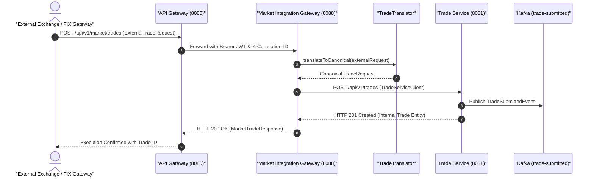

# 🏛️ Market Integration Gateway Architecture & Technical Specification

> **Component:** `market-integration-gateway`  
> **Author & Architect:** Pulkit Mathur ([@Pulkit1822](https://github.com/Pulkit1822))  
> **Port:** `8088` | **Base Package:** `com.clearing.marketgateway`  
> **Runtime:** Java 21 LTS | Spring Boot 3.3.0 | Spring Cloud OpenFeign / RestClient | Apache Kafka  

---

## 1. Executive Summary & Purpose

The **Market Integration Gateway** is the perimeter protocol abstraction and translation layer for the Clearing and Settlement platform. External electronic communications networks (ECNs), bilateral crossing engines, and institutional stock exchanges (e.g., NASDAQ, NYSE, LSE) communicate via heterogeneous protocols (FIX 4.2/4.4/5.0, FAST, custom JSON). 

The gateway insulates internal clearing services from external vendor formats by ingesting external execution messages, normalizing them into the platform's canonical `TradeRequest` domain model, and forwarding them reliably into the core clearing pipeline.

### Real-World Analogy
```
  International Airport Customs & Currency Exchange    Market Integration Gateway
  ────────────────────────────────────────────────────────────────────────────────────────
  Foreign traveler arrives with passport & foreign cash  ──► Ingests vendor execution (FIX / JSON)
  Customs agent verifies passport validity               ──► Validates broker credentials & format
  Exchanges foreign notes into domestic legal tender     ──► Translates external schema to canonical TradeRequest
  Traveler enters domestic transit network               ──► Forwards trade to internal clearing pipeline
```

> **In simple terms:** External exchanges speak different technical dialects (some use FIX Tag 55 for Symbol, others use JSON `symbol`, others use ISO ISIN codes). The Market Integration Gateway acts as the universal translator so internal services only ever deal with one clean, unified format.

---

## 2. Platform Topology & Pipeline Integration



---

## 3. Concrete Numerical Translation Walkthrough

### Inbound External Vendor Payload (`ExternalTradeRequest`)
```json
{
  "sourceVenue": "NASDAQ",
  "externalExecutionId": "NSDQ-20261025-883910",
  "symbol": "aapl",
  "buyerId": "ACC-BUYER-001",
  "sellerId": "ACC-SELLER-002",
  "shares": 500,
  "unitPrice": 182.25,
  "timestamp": "2026-10-25T16:45:00Z"
}
```

### Canonical Mapping Applied by `TradeTranslator`:
```
  Translation Mapping:
  ├── symbol ("aapl")            ──► instrumentId ("AAPL") [Upper-cased]
  ├── buyerId ("ACC-BUYER-001")   ──► buyerAccountId ("ACC-BUYER-001")
  ├── sellerId ("ACC-SELLER-002") ──► sellerAccountId ("ACC-SELLER-002")
  ├── shares (500)               ──► quantity (Integer 500)
  └── unitPrice (182.25)         ──► price (BigDecimal "182.2500")
```

### Outbound Canonical Payload Sent to Trade Service (`TradeRequest`):
```json
{
  "instrumentId": "AAPL",
  "buyerAccountId": "ACC-BUYER-001",
  "sellerAccountId": "ACC-SELLER-002",
  "quantity": 500,
  "price": 182.25
}
```

### Response Returned to External Venue (`MarketTradeResponse`):
```json
{
  "tradeId": "c89b0d39-6cb4-49c2-9e95-728b78f44ff5",
  "status": "ACCEPTED",
  "message": "Trade successfully translated and submitted to clearing pipeline",
  "timestamp": "2026-10-25T16:45:00.180Z"
}
```

---

## 4. Class Hierarchy & Architectural Structure

```
market-integration-gateway/
└── src/main/java/com/clearing/marketgateway/
    │
    ├── MarketIntegrationGatewayApplication.java      ← Spring Boot 3 bootstrap
    │
    ├── controller/
    │   └── MarketTradeController.java                 ← Inbound REST controller (/api/v1/market)
    │
    ├── translator/
    │   └── TradeTranslator.java                       ← Canonical protocol mapping logic
    │
    ├── client/
    │   ├── TradeServiceClient.java                    ← HTTP client targeting Trade Service
    │   ├── TradeServiceClientConfig.java              ← Resilience & timeout configuration
    │   └── TradeServiceException.java                 ← Custom exception handling downstream errors
    │
    └── dto/
        ├── ExternalTradeRequest.java                  ← Inbound external trade schema
        └── MarketTradeResponse.java                   ← Acknowledgment schema
```

---

## 5. Classes Explained with Line-by-Line Code Breakdown

### 5.1 MarketTradeController (`controller/MarketTradeController.java`)

```java
@RestController
@RequestMapping("/api/v1/market")
public class MarketTradeController {

    private final TradeTranslator tradeTranslator;
    private final TradeServiceClient tradeServiceClient;

    @PostMapping("/trades")
    public ResponseEntity<MarketTradeResponse> ingestExternalTrade(
            @Valid @RequestBody ExternalTradeRequest externalRequest) {
        // 1. Translate external schema to canonical internal schema
        TradeRequest canonicalRequest = tradeTranslator.toTradeRequest(externalRequest);

        // 2. Forward to TradeService over HTTP
        JsonNode tradeResponse = tradeServiceClient.submitTrade(canonicalRequest);

        // 3. Return acknowledgment receipt to the market venue
        String internalTradeId = tradeResponse.get("id").asText();
        MarketTradeResponse response = new MarketTradeResponse(
                internalTradeId,
                "ACCEPTED",
                "Trade successfully translated and submitted to clearing pipeline",
                Instant.now()
        );
        return ResponseEntity.ok(response);
    }
}
```

| Line / Element | Architectural Purpose |
|---|---|
| `@RequestMapping("/api/v1/market")` | External intake namespace exposed to brokers and market data connectors. |
| `@Valid @RequestBody ExternalTradeRequest` | Validates mandatory external fields (non-null shares, symbol, venue). |
| `tradeTranslator.toTradeRequest()` | Pure function normalizing external symbology into standard canonical format. |
| `tradeServiceClient.submitTrade()` | Dispatches to internal core cluster with circuit breaking and correlation headers. |

---

### 5.2 TradeTranslator (`translator/TradeTranslator.java`)

```java
@Component
public class TradeTranslator {

    public TradeRequest toTradeRequest(ExternalTradeRequest external) {
        return new TradeRequest(
                external.symbol().toUpperCase().trim(),
                external.buyerId().trim(),
                external.sellerId().trim(),
                external.shares(),
                BigDecimal.valueOf(external.unitPrice())
        );
    }
}
```

| Step | Operation | Technical Explanation |
|---|---|---|
| `toUpperCase().trim()` | Normalization | Sanitizes ticker symbols to match golden reference data formatting. |
| `BigDecimal.valueOf()` | Precision Protection | Converts floating-point external prices to arbitrary-precision decimals, preventing float rounding errors. |

---

## 6. Staff-Level Interview Questions & Deep Dives

### Q1: Why have a dedicated Market Integration Gateway instead of allowing exchanges to talk directly to Trade Service?
> **Answer:** Boundary separation and anti-corruption layer (Domain-Driven Design). External exchanges frequently update their message specs, field names, or authentication schemes. Connecting them directly to `TradeService` would force database schemas and core business logic to change whenever an external exchange alters its API. The gateway acts as a shock absorber that preserves internal model purity.

### Q2: How does the Gateway handle downstream outages in Trade Service?
> **Answer:** `TradeServiceClientConfig` configures strict connection timeouts (2 seconds) and read timeouts (5 seconds). If `trade-service` is unreachable, `TradeServiceException` intercepts the failure and returns an informative HTTP 502/503 response containing the external execution ID (`NSDQ-20261025-883910`). This enables the external broker or FIX engine to queue and retry safely without creating duplicate executions.

### Q3: How is end-to-end distributed tracing maintained?
> **Answer:** The gateway extracts or generates an `X-Correlation-ID` header upon request receipt. It injects this token into the downstream HTTP client call to `trade-service:8081`. As `trade-service`, `position-service`, and `clearing-service` process the trade, they log the same correlation ID across MDC contexts, enabling unified log searching in Elasticsearch/Kibana.
