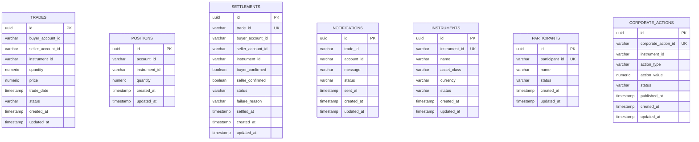

# 🗄️ Database Architecture & Schema Specification

> **Platform:** Post-Trade Clearing & Settlement Platform  
> **Author & Maintainer:** Pulkit Mathur ([@Pulkit1822](https://github.com/Pulkit1822))  
> **Database Engine:** PostgreSQL 16 Alpine (`clearing-db`)  
> **Migration Engine:** Flyway 10.x (Deterministic, Version-Controlled, Idempotent)

---

## 1. Architectural Philosophy: Database-per-Service

The platform enforces strict bounded contexts following the **Database-per-Service** design pattern:
- **No Direct Cross-Service Queries**: No microservice is permitted to join or query tables owned by another microservice.
- **Isolated Flyway History**: Each microservice maintains its own independent schema history table (e.g. `clearing_flyway_history`, `position_flyway_history`), eliminating migration lock contention on boot.
- **Event-Driven Synchronization**: Data propagation across domain boundaries occurs strictly over Apache Kafka event streams.

---

## 2. Platform Entity-Relationship (ER) Overview

---

## 3. Microservice Schema Definitions

### 1. Trade Service Schema
* **Table:** `trades`
* **Flyway Table:** `flyway_schema_history`
* **Migration Scripts:** `V1__initial_schema.sql`, `V2__rename_account_columns.sql`

| Column | Type | Constraints | Description |
|:---|:---|:---|:---|
| `id` | `UUID` | `PRIMARY KEY` | Globally unique trade identifier |
| `buyer_account_id` | `VARCHAR(50)` | `NOT NULL`, Indexed | Account ID of purchasing participant |
| `seller_account_id` | `VARCHAR(50)` | `NOT NULL`, Indexed | Account ID of selling participant |
| `instrument_id` | `VARCHAR(50)` | `NOT NULL` | Ticker symbol or ISIN (e.g. `AAPL`) |
| `quantity` | `NUMERIC(19,4)` | `NOT NULL` | Number of units executed |
| `price` | `NUMERIC(19,4)` | `NOT NULL` | Price per unit in instrument currency |
| `trade_date` | `TIMESTAMP` | `NOT NULL` | Matching engine execution timestamp |
| `status` | `VARCHAR(30)` | `NOT NULL`, Indexed | `SUBMITTED`, `VALIDATED`, `REJECTED`, `SETTLED` |
| `created_at` | `TIMESTAMP` | `DEFAULT CURRENT_TIMESTAMP` | Intake audit timestamp |
| `updated_at` | `TIMESTAMP` | `DEFAULT CURRENT_TIMESTAMP` | Last status update timestamp |

---

### 2. Position Service Schema
* **Table:** `positions`
* **Flyway Table:** `position_flyway_history`
* **Migration Scripts:** `V1__initial_schema.sql`

| Column | Type | Constraints | Description |
|:---|:---|:---|:---|
| `id` | `UUID` | `PRIMARY KEY` | Unique record identifier |
| `account_id` | `VARCHAR(50)` | `NOT NULL` | Participant or investor account ID |
| `instrument_id` | `VARCHAR(50)` | `NOT NULL` | Target asset identifier |
| `quantity` | `NUMERIC(19,4)` | `NOT NULL DEFAULT 0` | Net settled holding quantity |
| `created_at` | `TIMESTAMP WITH TZ`| `DEFAULT CURRENT_TIMESTAMP` | Record creation timestamp |
| `updated_at` | `TIMESTAMP WITH TZ`| `DEFAULT CURRENT_TIMESTAMP` | Last position debit/credit timestamp |

> **Critical Database Constraint:**  
> `CONSTRAINT uc_account_instrument UNIQUE (account_id, instrument_id)`  
> Guarantees that each trading account has at most **one** row per security. This allows Spring Data JPA's `PESSIMISTIC_WRITE` locks (`SELECT ... FOR UPDATE`) to reliably acquire a row lock and prevent double-spending under concurrent trade volume.

---

### 3. Clearing Service Schema
* **Table:** `settlements`
* **Flyway Table:** `clearing_flyway_history`
* **Migration Scripts:** `V1__initial_schema.sql`

| Column | Type | Constraints | Description |
|:---|:---|:---|:---|
| `id` | `UUID` | `PRIMARY KEY` | Settlement instruction ID |
| `trade_id` | `VARCHAR(36)` | `NOT NULL UNIQUE` | Natural key referencing original trade |
| `buyer_account_id` | `VARCHAR(50)` | Indexed | Purchasing participant |
| `seller_account_id` | `VARCHAR(50)` | Indexed | Selling participant |
| `instrument_id` | `VARCHAR(50)` | Nullable | Financial asset settling |
| `buyer_confirmed` | `BOOLEAN` | `DEFAULT FALSE` | Buyer position credit status |
| `seller_confirmed` | `BOOLEAN` | `DEFAULT FALSE` | Seller position debit status |
| `status` | `VARCHAR(30)` | `NOT NULL`, Indexed | `PENDING`, `SETTLED`, `FAILED` |
| `failure_reason` | `VARCHAR(500)` | Nullable | Exception or fail code if settlement aborted |
| `settled_at` | `TIMESTAMP` | Nullable | DvP finality timestamp |
| `created_at` | `TIMESTAMP` | `DEFAULT CURRENT_TIMESTAMP` | Intake timestamp |
| `updated_at` | `TIMESTAMP` | `DEFAULT CURRENT_TIMESTAMP` | Last audit update |

---

### 4. Notification Service Schema
* **Table:** `notifications`
* **Flyway Table:** `notification_flyway_history`
* **Migration Scripts:** `V1__initial_schema.sql`

| Column | Type | Constraints | Description |
|:---|:---|:---|:---|
| `id` | `UUID` | `PRIMARY KEY` | Notification dispatch ID |
| `trade_id` | `VARCHAR(36)` | `NOT NULL`, Indexed | Target trade reference |
| `account_id` | `VARCHAR(50)` | `NOT NULL`, Indexed | Recipient account |
| `message` | `VARCHAR(500)` | `NOT NULL` | Advisory message body |
| `status` | `VARCHAR(20)` | `NOT NULL`, Indexed | `SENT`, `FAILED`, `PENDING` |
| `sent_at` | `TIMESTAMP` | Nullable | Dispatch timestamp |
| `created_at` | `TIMESTAMP` | `DEFAULT CURRENT_TIMESTAMP` | Notification creation time |
| `updated_at` | `TIMESTAMP` | `DEFAULT CURRENT_TIMESTAMP` | Last status update |

---

### 5. Reference Data Service Schema
* **Tables:** `instruments`, `participants`
* **Flyway Table:** `refdata_flyway_history`
* **Migration Scripts:** `V1__initial_schema.sql`

#### Table: `instruments`
| Column | Type | Constraints | Description |
|:---|:---|:---|:---|
| `id` | `UUID` | `PRIMARY KEY` | Unique entity ID |
| `instrument_id` | `VARCHAR(20)` | `NOT NULL UNIQUE` | Symbol or ISIN (e.g., `AAPL`, `MSFT`) |
| `name` | `VARCHAR(100)` | `NOT NULL` | Security descriptive name |
| `asset_class` | `VARCHAR(30)` | `NOT NULL` | `EQUITY`, `BOND`, `DERIVATIVE` |
| `currency` | `VARCHAR(10)` | `NOT NULL` | Base trading currency (e.g., `USD`) |
| `status` | `VARCHAR(20)` | `NOT NULL`, Indexed | `ACTIVE`, `HALTED`, `DELISTED` |

#### Table: `participants`
| Column | Type | Constraints | Description |
|:---|:---|:---|:---|
| `id` | `UUID` | `PRIMARY KEY` | Unique entity ID |
| `participant_id` | `VARCHAR(50)` | `NOT NULL UNIQUE` | Clearing member / broker identifier |
| `name` | `VARCHAR(100)` | `NOT NULL` | Institutional broker or fund name |
| `status` | `VARCHAR(20)` | `NOT NULL`, Indexed | `ACTIVE`, `SUSPENDED` |

---

### 6. Corporate Action Service Schema
* **Table:** `corporate_actions`
* **Flyway Table:** `corporate_action_flyway_history`
* **Migration Scripts:** `V1__initial_schema.sql`

| Column | Type | Constraints | Description |
|:---|:---|:---|:---|
| `id` | `UUID` | `PRIMARY KEY` | Action record ID |
| `corporate_action_id`| `VARCHAR(36)` | `NOT NULL UNIQUE` | Announcement identifier |
| `instrument_id` | `VARCHAR(20)` | `NOT NULL`, Indexed | Target security |
| `action_type` | `VARCHAR(20)` | `NOT NULL` | `STOCK_SPLIT`, `DIVIDEND`, `BONUS` |
| `action_value` | `NUMERIC(19,4)` | `NOT NULL` | Split ratio (e.g. `2.0` for 2:1) or cash dividend per share |
| `status` | `VARCHAR(20)` | `NOT NULL`, Indexed | `ANNOUNCED`, `PROCESSED`, `CANCELLED` |
| `published_at` | `TIMESTAMP` | Nullable | Execution / Ex-date timestamp |
