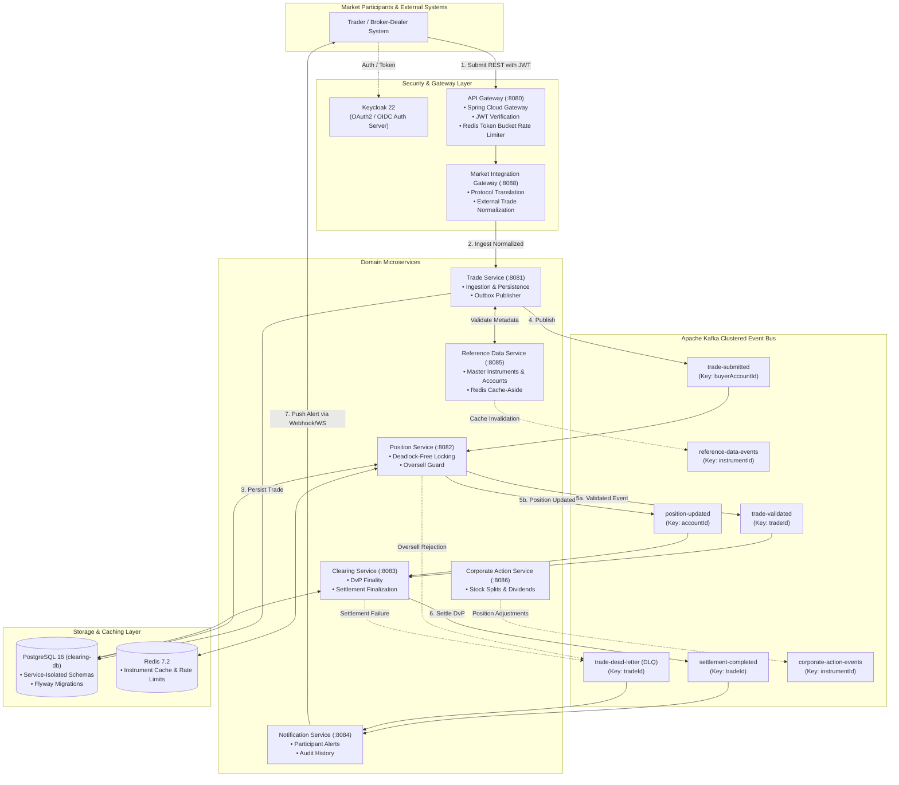
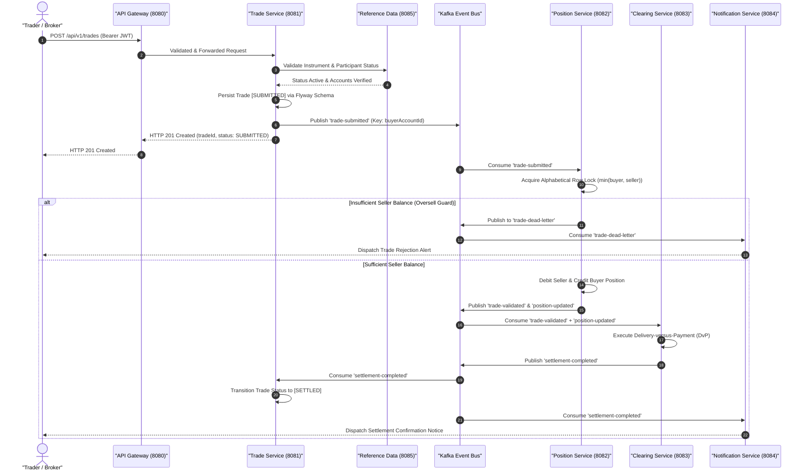

# 🏛️ System Architecture — Post-Trade Clearing & Settlement Platform

> **Document Version:** 2.0.0  
> **Author & Maintainer:** Pulkit Mathur ([@Pulkit1822](https://github.com/Pulkit1822))  
> **Architecture Pattern:** Event-Driven Microservices (Hexagonal + CQRS + Transactional Outbox)  
> **Core Runtime:** Java 21 LTS | Spring Boot 3.3.5 | Apache Kafka 3.x | PostgreSQL 16 | Redis 7.2 | Keycloak 22

---

## 1. System Overview & Core Mission

The **Post-Trade Clearing Platform** is a distributed, event-driven financial transaction processing backend engineered to simulate institutional clearing house (CCP) and central securities depository (CSD) operations.

Following order execution on a matching engine or exchange, this platform handles the post-trade lifecycle:
1. **Trade Intake & Validation**: Real-time schema validation, participant account verification, and idempotency checks.
2. **Pessimistic Position Allocation & Oversell Guard**: Deadlock-free alphabetical balance locking and atomic asset transfers.
3. **Delivery-versus-Payment (DvP) Clearing**: Bilateral cash and security finality ensuring neither party is exposed to principal settlement risk.
4. **Corporate Action Adjustments**: Stock splits, dividends, and bonus share adjustments applied to active holdings.
5. **Real-Time Notification & Auditing**: Multichannel advisories (webhooks/websockets) and immutable audit trails.

---

## 2. High-Level Architectural Topology



---

## 3. Microservice Catalog & Port Matrix

| Service | Port | Database Schema | Primary Responsibilities |
|---------|:----:|-----------------|--------------------------|
| **`api-gateway`** | `8080` | *None* (Redis cache) | Edge reverse proxy, JWT claim verification, rate limiting, and request correlation tracing |
| **`market-integration-gateway`** | `8088` | *Stateless* | Ingestion of raw external orders (REST/FIX), validation, and translation to canonical `TradeRequest` |
| **`trade-service`** | `8081` | `trades` | Trade entity persistence (`SUBMITTED`), idempotency verification, and event publication |
| **`position-service`** | `8082` | `positions` | Account position ledgers, deterministic lock ordering, balance debits/credits, and oversell guard |
| **`clearing-service`** | `8083` | `settlements` | Multi-event orchestration (`trade-validated` + `position-updated`), DvP finality, and settlement records |
| **`reference-data-service`** | `8085` | `instruments`, `participants` | Master instruments catalog, participant accounts, exchange schedules, and Redis cache-aside |
| **`corporate-action-service`** | `8086` | `corporate_actions` | Stock splits, cash dividends, and bonus allocations modifying holding positions |
| **`notification-service`** | `8084` | `notifications` | Participant advisories, webhook alerts, email dispatch simulation, and audit queries |

---

## 4. End-to-End Trade Clearing Lifecycle



---

## 5. Architectural Guarantees & Concurrency Controls

### 1. Deadlock-Free Lock Ordering
To prevent RDBMS distributed circular-wait deadlocks under high-frequency trading bursts, `PositionValidationService` enforces **strict alphabetical lock acquisition**:
```java
final String firstId = buyerId.compareTo(sellerId) < 0 ? buyerId : sellerId;
final String secondId = firstId.equals(buyerId) ? sellerId : buyerId;

Position firstPos = getOrCreatePosition(firstId, instrumentId);
Position secondPos = isSelfTrade ? firstPos : getOrCreatePosition(secondId, instrumentId);
```
Regardless of trade direction, the account with the smaller ID is always locked first.

### 2. Partition-Level Serial Ordering
Kafka topics are partitioned with explicit business keys:
* `trade-submitted`: Keyed by `buyerAccountId` $\rightarrow$ all buy transactions for an account process in FIFO sequence.
* `position-updated`: Keyed by `accountId` $\rightarrow$ maintains exact chronological ledger updates without race conditions.
* `settlement-completed`: Keyed by `tradeId` $\rightarrow$ maintains trade-specific idempotent processing.

### 3. Database per Service & Isolation
Each microservice maintains its own Flyway migration history table:
* `trades` $\rightarrow$ `flyway_schema_history`
* `clearing-service` $\rightarrow$ `clearing_flyway_history`
* `position-service` $\rightarrow$ `position_flyway_history`
* `notification-service` $\rightarrow$ `notification_flyway_history`
* `reference-data-service` $\rightarrow$ `refdata_flyway_history`
* `corporate-action-service` $\rightarrow$ `corporate_action_flyway_history`

Cross-service data queries occur strictly via asynchronous event subscriptions or caching layers, never direct cross-database SQL joins.
